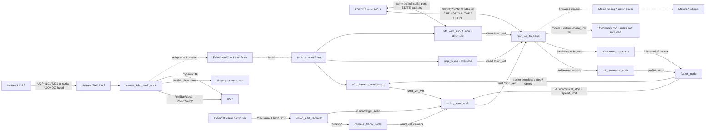
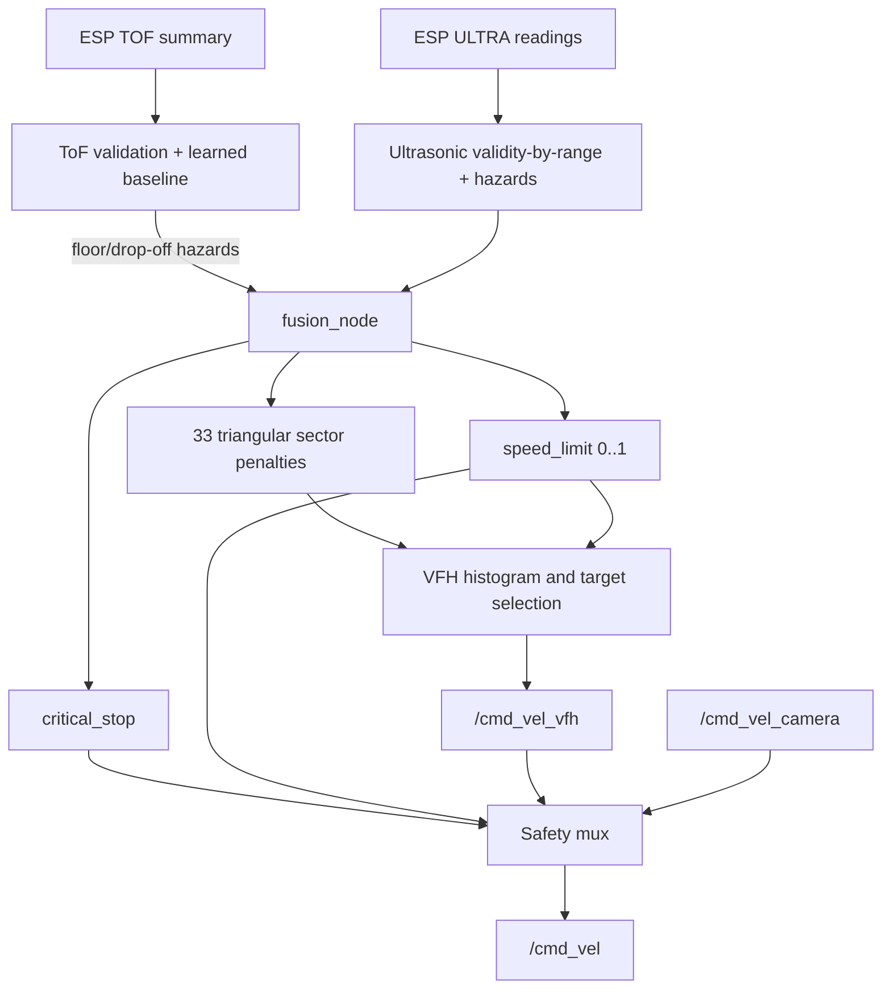

# Sensor-Fusion UGV: Codebase Deep Dive

This document is a second-pass, implementation-first analysis of the repository as it exists currently, with emphasis on `ws/src`. It is both a technical reference and a learning guide. Source code is treated as authoritative; names, comments, and older documentation are not accepted as proof of behavior.

Evidence labels used throughout:

- **Verified from code:** directly implemented in a file named in the text.
- **Likely intent:** strongly suggested by connections or naming, but not provable without missing code or hardware.
- **Documentation says:** stated by project documentation, not independently established by implementation.
- **Potential issue:** a discrepancy, failure mode, or engineering concern found during static inspection.

No implementation code was changed during this analysis.

## Executive findings

The repository contains a plausible modular ROS 2 autonomy stack, but it is not currently a complete, launchable end-to-end robot stack on its own.

The richest internally connected path is:

```text
ESP telemetry -> ToF/ultrasonic processors -> fusion_node
                                             | penalties/stop/speed
external /scan ------------------------------+-> vfh_obstacle_avoidance
camera UART -> vision receiver -> camera follower      |
                                      \                | /cmd_vel_vfh
                                       +-> safety_mux <-+
                                              |
                                         final /cmd_vel
                                              |
                                      cmd_vel_to_serial
                                              |
                                       ESP serial CMD
```

There are four decisive qualifications:

1. **No source file publishes `/scan`.** The Unitree driver publishes `/unilidar/cloud` (`PointCloud2`) and `/unilidar/imu` (`Imu`). All three navigation implementations and the logger require `LaserScan` on `/scan`. A point-cloud-to-scan adapter or a different scan source is absent.
2. **The checked-in Unitree ROS wrapper has SDK include/library paths that resolve outside the actual SDK directory.** Its `CMakeLists.txt` uses `../../../unitree_lidar_sdk/...`; the SDK is the sibling `../unitree_lidar_sdk/...`. The referenced paths do not exist in this checkout.
3. **There are multiple command owners.** The safety mux publishes `/cmd_vel`, but `gap_follow` and `esp_lidar_fusion_driver` also publish `/cmd_vel` directly. ROS does not arbitrate those publishers; a subscriber can receive interleaved commands.
4. **Motor firmware is absent.** The host bridge proves that `CMD v <value> w <value>\n` is sent to a serial device. How the ESP32 validates it, maps it to wheel/motor-driver signals, applies braking, or reports acknowledgements cannot be verified.

The code therefore represents a collection of connected core modules plus alternative experiments, rather than one fully orchestrated production configuration.

## Five-minute architecture summary

**Verified from code:** The host side is designed for ROS 2. `README.md` and `build_ws.sh` target Ubuntu 24.04 and ROS 2 Jazzy, and the README names a Raspberry Pi as a target host. A Unitree SDK can receive LiDAR packets over UDP or high-speed serial. The ROS wrapper converts those packets into a 3D point cloud, IMU messages, and two TF transforms.

An ESP-connected bridge has two jobs. It sends the latest planar ROS velocity command as an ASCII serial line 30 times per second, forcing zero after 0.25 seconds without a new command. In the other direction it parses odometry, a front ToF summary, and four named ultrasonic readings. ROS processors convert the ToF and front/left/right ultrasonic summaries into dimensionless hazards. `fusion_node` turns those hazards into a 33-sector penalty array, a critical-stop Boolean, and a 0-to-1 speed multiplier.

The standalone VFH controller combines `/scan` geometry with those fusion outputs and publishes `/cmd_vel_vfh`. A UART receiver parses external vision detections; a camera-follow controller turns target angle and bounding-box area into `/cmd_vel_camera`. The safety mux gives a fusion critical stop highest priority, then a recent camera command for a recently seen target, then a recent VFH command. Its output `/cmd_vel` is the input to the ESP bridge.

`gap_follow` is a simpler LiDAR-only alternative that bypasses the mux. `esp_lidar_fusion_driver` is another alternative that combines its own VFH logic with a different ESP `STATE|...` serial protocol and also bypasses the mux. These modes are not selected by any checked-in launch or supervisor.

**Likely intent:** The ESP32 owns wheel odometry, ToF/ultrasonic acquisition, and low-level motor control. Only the serial contract supports that inference; the firmware, motor-driver code, encoder code, and wiring are not in the repository.

## Actual system architecture

### Computers and controllers

| Compute/device                                                          | Responsibilities verified in this repository                                                                                        | What is not provable here                                                                                                               |
| ----------------------------------------------------------------------- | ----------------------------------------------------------------------------------------------------------------------------------- | --------------------------------------------------------------------------------------------------------------------------------------- |
| Ubuntu ROS 2 host, documented as Raspberry Pi or another Ubuntu machine | Runs drivers, processing, fusion, navigation, vision control, mux, logging, TF, and the ESP serial bridge                           | Exact board, operating image, CPU architecture, and which nodes run in the field                                                        |
| Unitree LiDAR internal controller                                       | Emits Unitree protocol point and IMU packets over serial or UDP; accepts SDK control/configuration calls                            | Exact LiDAR model and physical mounting. `CODEBASE_OVERVIEW.md` calls it an L2, but the inspected SDK headers do not identify the model |
| ESP32 or similar serial MCU                                             | The project documentation calls it ESP32; host code sends `CMD` and expects `ODOM`, `TOF`, `ULTRA`, or alternate `STATE` lines      | Firmware behavior, sensor drivers, encoder math, motor mixing, ACKs, GPIO, motor-driver type, and failsafe behavior                     |
| External vision computer                                                | A code comment says “Jetson sends 87 instead of 0.87”; sends line-oriented UART detections or two-character direction/stop messages | Camera model, detector, target class policy, frame rate, and sender implementation                                                      |
| Motor driver and drivetrain                                             | None in host source                                                                                                                 | Device type, differential/Ackermann layout, units accepted by firmware, braking, limits, and physical direction signs                   |

### Main rich stack versus alternatives

| Mode                      | Command producer                                                    | Safety/fusion used                                                | Final path                                     | Integration status                                                                                                                                       |
| ------------------------- | ------------------------------------------------------------------- | ----------------------------------------------------------------- | ---------------------------------------------- | -------------------------------------------------------------------------------------------------------------------------------------------------------- |
| Rich VFH + vision stack   | `/cmd_vel_vfh` and `/cmd_vel_camera`, selected by `safety_mux_node` | `fusion_node` penalties, critical stop, speed limit; mux timeouts | `/cmd_vel` -> `cmd_vel_to_serial`              | Most internally coherent, but needs an external `/scan` source and manual multi-node startup                                                             |
| Gap-follow mode           | `gap_follow` directly publishes `/cmd_vel`                          | LiDAR-only thresholds; ESP bridge command watchdog                | `/cmd_vel` -> `cmd_vel_to_serial`              | Bypasses ToF/ultrasonic fusion, camera arbitration, and mux safety                                                                                       |
| ESP+LiDAR integrated mode | `vfh_with_esp_fusion` directly publishes `/cmd_vel`                 | Its own rule-based ESP `STATE` fusion and `EMG` handling          | Needs a separate actuator bridge               | Incomplete with defaults: it and `cmd_vel_to_serial` both open `/dev/ttyACM0`, while the integrated node itself sends no motor commands after `PI_READY` |
| Unitree visualization     | Unitree wrapper only                                                | None                                                              | `/unilidar/cloud`, `/unilidar/imu`, TF -> RViz | Launch file covers this mode only; it does not start autonomy or publish `/scan`                                                                         |

## Complete system diagram

Solid edges are implemented. Dashed edges mark required or physical behavior that is absent from this repository.



### Sensor and safety flow



## Actual ROS 2 graph

### Node inventory

All Python publishers/subscribers created with integer depth `10` use the default rclpy QoS (keep-last depth 10, reliable, volatile unless ROS defaults are overridden externally). `qos_profile_sensor_data` is explicitly used only by `/scan` subscribers; it is the ROS sensor-data profile, normally best-effort and volatile. The C++ Unitree publishers use reliable keep-last depth 10. No services, service clients, actions, lifecycle nodes, or custom messages were found.

| ROS node name                                                                    | Package / executable                             | Source class              | Subscriptions                                                               | Publications                                                                                                                                    | Timers / trigger                                                |
| -------------------------------------------------------------------------------- | ------------------------------------------------ | ------------------------- | --------------------------------------------------------------------------- | ----------------------------------------------------------------------------------------------------------------------------------------------- | --------------------------------------------------------------- |
| `cmd_vel_to_serial`                                                              | `esp_bridge` / `cmd_vel_to_serial`               | `CmdVelToSerial`          | `/cmd_vel` `Twist`                                                          | `/odom` `Odometry`; `/tof/front/summary` `String`; `/esp/ultrasonic_raw` `String`; TF                                                           | command timer 30 Hz; serial RX timer 50 Hz                      |
| `vfh_with_esp_fusion`                                                            | `esp_fusion_pkg` / `esp_lidar_fusion_driver`     | `VFHWithEspFusion`        | `/scan` `LaserScan` (sensor QoS)                                            | `/cmd_vel` `Twist`                                                                                                                              | scan callback; serial is read only from that callback           |
| `fusion_node`                                                                    | `fusion_pkg` / `fusion_node`                     | `FusionNode`              | `/tof/features`, `/ultrasonic/features` `String`                            | `/fusion/sector_penalties` `Float32MultiArray`; `/fusion/critical_stop` `Bool`; `/fusion/speed_limit` `Float32`; `/fusion/debug_state` `String` | 10 Hz fusion timer                                              |
| `gap_follow`                                                                     | `gap_follow` / `gap_follow`                      | `GapFollow`               | `/scan` `LaserScan` (sensor QoS)                                            | `/cmd_vel` `Twist`                                                                                                                              | per scan                                                        |
| `lidar_logger`                                                                   | `lidar_logger_pkg` / `lidar_logger`              | `LidarLogger`             | `/scan` `LaserScan` (sensor QoS)                                            | no ROS publication; writes CSV                                                                                                                  | per scan                                                        |
| `tof_processor_node`                                                             | `tof_processor_pkg` / `tof_processor_node`       | `TofProcessorNode`        | `/tof/front/summary` `String`                                               | `/tof/features` `String`                                                                                                                        | 15 Hz processing timer                                          |
| `ultrasonic_processor`                                                           | `ultrasonic_pkg` / `ultrasonic_processor`        | `UltrasonicProcessorNode` | `/esp/ultrasonic_raw` `String`                                              | `/ultrasonic/features` `String`                                                                                                                 | 10 Hz processing/stale timer                                    |
| `vfh_obstacle_avoidance`                                                         | `vfh_pkg` / `vfh_node`                           | `VFHObstacleAvoidance`    | `/scan` `LaserScan` (sensor QoS); three `/fusion/*` topics                  | `/cmd_vel_vfh` `Twist`                                                                                                                          | per scan                                                        |
| `vision_uart_receiver`                                                           | `vision_uart_pkg` / `vision_uart_receiver_node`  | `VisionUartReceiver`      | no ROS subscriptions; serial input                                          | seven `/vision/*` topics                                                                                                                        | requested 50 Hz read timer; 10 Hz target timeout timer          |
| `camera_follow_node`                                                             | `vision_uart_pkg` / `camera_follow_node`         | `CameraFollowNode`        | five `/vision/*` topics                                                     | `/cmd_vel_camera` `Twist`; `/vision/follow_debug` `String`                                                                                      | 20 Hz controller                                                |
| `safety_mux_node`                                                                | `vision_uart_pkg` / `safety_mux_node`            | `SafetyMuxNode`           | `/cmd_vel_camera`, `/cmd_vel_vfh`, `/vision/target_seen`, fusion stop/speed | `/cmd_vel` `Twist`; `/mux/debug` `String`                                                                                                       | 20 Hz arbitration                                               |
| `unitre_lidar_sdk_node` direct, launch overrides it to `unitree_lidar_ros2_node` | `unitree_lidar_ros2` / `unitree_lidar_ros2_node` | `UnitreeLidarSDKNode`     | no ROS subscriptions; SDK input                                             | relative `unilidar/cloud` `PointCloud2`; relative `unilidar/imu` `Imu`; TF                                                                      | 1 ms wall timer polls SDK; publication is packet-driven         |
| `rviz2` (external ROS package)                                                   | `rviz2` / `rviz2`                                | RViz application          | `/unilidar/cloud`, TF (from config)                                         | interactive `/initialpose`, `/goal_pose`, `/clicked_point` when tools are used                                                                  | launched with Unitree node; 30 Hz configured display frame rate |

There are 11 Python `setup.py` console entry points and one C++ ROS executable. All are accounted for above.

### Text graph with producer/consumer checks

```text
Unitree SDK node
  +--> /unilidar/cloud [PointCloud2] --> RViz only
  +--> /unilidar/imu   [Imu] --------> no project subscriber
  +--> /tf --------------------------> RViz/TF tools

MISSING PRODUCER --> /scan [LaserScan]
  +--> gap_follow --------------------> /cmd_vel
  +--> lidar_logger ------------------> CSV
  +--> vfh_obstacle_avoidance --------> /cmd_vel_vfh
  +--> vfh_with_esp_fusion -----------> /cmd_vel

ESP serial --> cmd_vel_to_serial
  +--> /odom [Odometry] --------------> no project subscriber
  +--> /tf odom->base_link -----------> no checked-in consumer
  +--> /tof/front/summary ------------> tof_processor_node
  |                                      +--> /tof/features --> fusion_node
  +--> /esp/ultrasonic_raw -----------> ultrasonic_processor
                                         +--> /ultrasonic/features --> fusion_node

fusion_node
  +--> /fusion/sector_penalties ------> vfh_obstacle_avoidance
  +--> /fusion/critical_stop ---------> vfh_obstacle_avoidance, safety_mux_node
  +--> /fusion/speed_limit -----------> vfh_obstacle_avoidance, safety_mux_node
  +--> /fusion/debug_state -----------> no project subscriber

vision UART --> vision_uart_receiver
  +--> /vision/direction -------------> no project subscriber
  +--> /vision/stop_active -----------> camera_follow_node
  +--> /vision/target_seen -----------> camera_follow_node, safety_mux_node
  +--> /vision/target_angle ----------> camera_follow_node
  +--> /vision/target_confidence -----> camera_follow_node
  +--> /vision/target_box ------------> camera_follow_node
  +--> /vision/debug -----------------> no project subscriber

camera_follow_node --> /cmd_vel_camera --> safety_mux_node
vfh_obstacle_avoidance --> /cmd_vel_vfh --> safety_mux_node
safety_mux_node --> /cmd_vel --> cmd_vel_to_serial --> ESP serial
```

RViz also configures interactive tool topics `/initialpose`, `/goal_pose`, and `/clicked_point`. They are RViz UI outputs, have no checked-in consumers, and are not part of autonomous behavior.

## Who talks to whom

| Source device/node             | Interface/topic                                         | Data                                                   | Destination                             | Purpose/status                                      |
| ------------------------------ | ------------------------------------------------------- | ------------------------------------------------------ | --------------------------------------- | --------------------------------------------------- |
| Unitree LiDAR                  | UDP `6101`/`6201` or serial `/dev/ttyACM0` at 4,000,000 | Vendor-framed point, IMU, config, and ACK packet types | Unitree SDK                             | Hardware acquisition; launch selects UDP            |
| Unitree SDK                    | C++ API                                                 | `PointCloudUnitree`, `LidarImuData`                    | `UnitreeLidarSDKNode`                   | Vendor parsing and cloud assembly                   |
| Unitree ROS node               | `/unilidar/cloud`                                       | XYZ, intensity, ring, relative point time              | RViz                                    | Visualization; no navigation consumer               |
| Unitree ROS node               | `/unilidar/imu`                                         | quaternion, angular velocity, acceleration             | none in project                         | Published but unused internally                     |
| Missing component              | `/scan`                                                 | 2D polar ranges                                        | gap follow, VFH, ESP-fusion VFH, logger | Required producer absent                            |
| Safety mux                     | `/cmd_vel`                                              | planar `Twist`                                         | ESP bridge                              | Canonical final command in rich stack               |
| Gap follow / ESP-fusion driver | `/cmd_vel`                                              | planar `Twist`                                         | ESP bridge                              | Alternate direct paths; conflict if run with mux    |
| ESP bridge                     | serial `CMD v … w …\n`                                  | direct numeric `linear.x`, `angular.z`                 | ESP firmware                            | Final host-to-controller interface; firmware absent |
| ESP firmware                   | serial `ODOM ...`                                       | x, y, heading, v, w                                    | ESP bridge                              | Odometry contract inferred from parser              |
| ESP firmware                   | serial `TOF\|...`                                       | front summary                                          | ESP bridge -> ToF processor             | Sensor model/raw matrix absent                      |
| ESP firmware                   | serial `ULTRA\|...`                                     | front/left/right/back distances and valid flags        | ESP bridge -> ultrasonic processor      | Rear/valid flags later ignored                      |
| ToF processor                  | `/tof/features`                                         | hazards and baselines encoded as string                | fusion node                             | Floor/drop-off feature extraction                   |
| Ultrasonic processor           | `/ultrasonic/features`                                  | three directions and hazards encoded as string         | fusion node                             | Near-obstacle feature extraction                    |
| Fusion node                    | three `/fusion/*` control topics                        | sector penalties, stop, speed multiplier               | VFH and mux                             | Rule-based additive/max/min fusion                  |
| Vision computer                | UART `/dev/serial0`, 115200                             | two-character state or seven-field CSV detection       | vision receiver                         | External perception boundary                        |
| Vision receiver                | `/vision/*`                                             | target state, angle, confidence, box, stop             | camera follower and mux                 | Typed ROS fan-out of UART fields                    |
| Camera follower                | `/cmd_vel_camera`                                       | smoothed target-follow `Twist`                         | safety mux                              | Candidate command                                   |
| VFH                            | `/cmd_vel_vfh`                                          | scan/fusion avoidance `Twist`                          | safety mux                              | Candidate command                                   |
| ESP firmware                   | motor-driver interface                                  | unknown                                                | motor driver/motors                     | Not present; cannot be verified                     |

## Publisher reference

Only fields actually assigned or relied upon are listed. A “rate” of “per scan/line” is input-driven, not a guaranteed frequency.

| Node                     | Topic and type                                                      | Created / published by                                     | Trigger and typical contents                                                                                  | Units/frame                                                                                                   | Project consumers                             |
| ------------------------ | ------------------------------------------------------------------- | ---------------------------------------------------------- | ------------------------------------------------------------------------------------------------------------- | ------------------------------------------------------------------------------------------------------------- | --------------------------------------------- |
| `cmd_vel_to_serial`      | `/odom` `nav_msgs/Odometry`                                         | constructor / `handle_odom_line()`                         | Each valid `ODOM` serial line; planar x/y/yaw and linear x/angular z                                          | ROS convention suggests m, rad, m/s, rad/s, but firmware contract does not state units; `odom` -> `base_link` | none checked in                               |
| `cmd_vel_to_serial`      | `/tof/front/summary` `std_msgs/String`                              | constructor / `handle_tof_line()`                          | Each valid front `TOF\|` line; `ID,T,VALID,CENTER,NEAR_MIN,NEAR_AVG,FAR_AVG`                                  | `T` variable is named milliseconds; distance unit unspecified                                                 | `tof_processor_node`                          |
| `cmd_vel_to_serial`      | `/esp/ultrasonic_raw` `String`                                      | constructor / `handle_ultra_line()`                        | Each valid `ULTRA\|` line; timestamp, four distances, four validity flags                                     | distances are treated as cm downstream                                                                        | `ultrasonic_processor`                        |
| `cmd_vel_to_serial`      | `/tf` `TransformStamped`                                            | `TransformBroadcaster` / `handle_odom_line()`              | Same valid odometry line; same pose as `/odom`                                                                | parent `odom`, child `base_link`                                                                              | external TF tools only                        |
| `vfh_with_esp_fusion`    | `/cmd_vel` `geometry_msgs/Twist`                                    | constructor / `scan_callback()`                            | One command per usable scan and cached ESP state; zero on ESP `EMG`; normal or escape turn otherwise          | intended m/s and rad/s; only `linear.x`, `angular.z`                                                          | ESP bridge; conflicts with mux/gap publishers |
| `fusion_node`            | `/fusion/sector_penalties` `Float32MultiArray`                      | constructor / `publish_fusion()`                           | 10 Hz; 33 dimensionless values, negative/right through positive/left from about -80° to +80°; layout is empty | dimensionless                                                                                                 | VFH                                           |
| `fusion_node`            | `/fusion/critical_stop` `Bool`                                      | constructor / `publish_fusion()`                           | 10 Hz; OR of implemented ToF/ultrasonic stop rules                                                            | Boolean                                                                                                       | VFH, safety mux                               |
| `fusion_node`            | `/fusion/speed_limit` `Float32`                                     | constructor / `publish_fusion()`                           | 10 Hz; most restrictive sensor-derived multiplier in `[0,1]`                                                  | dimensionless                                                                                                 | VFH, safety mux                               |
| `fusion_node`            | `/fusion/debug_state` `String`                                      | constructor / `publish_fusion()`                           | 10 Hz; pipe-separated summary                                                                                 | mixed diagnostic units                                                                                        | no checked-in consumer                        |
| `gap_follow`             | `/cmd_vel` `Twist`                                                  | constructor / `publish_cmd()`                              | Per scan unless empty; direct LiDAR-only command, stop, or escape turn                                        | intended m/s, rad/s                                                                                           | ESP bridge; conflicts with mux/ESP-fusion     |
| `tof_processor_node`     | `/tof/features` `String`                                            | constructor / `publish_features()`                         | Up to 15 Hz after first input; raw/baseline/delta values plus `FLOOR`, `DROPOFF`, `STATE`                     | distances retain unspecified input unit; hazards dimensionless                                                | fusion node                                   |
| `ultrasonic_processor`   | `/ultrasonic/features` `String`                                     | constructor / `publish_features()`                         | 10 Hz, including explicit stale/no-echo messages; three directions, hazards, min/average                      | cm and dimensionless hazards                                                                                  | fusion node                                   |
| `vfh_obstacle_avoidance` | `/cmd_vel_vfh` `Twist`                                              | constructor / `scan_callback()`                            | Per scan; normal VFH, blocked escape, or fusion hazard escape                                                 | intended m/s, rad/s                                                                                           | safety mux                                    |
| `vision_uart_receiver`   | `/vision/direction` `String`                                        | constructor / `handle_direction()`                         | Each valid two-character packet; `left`, `center`, `right`, or `unknown`                                      | categorical                                                                                                   | none checked in                               |
| `vision_uart_receiver`   | `/vision/stop_active` `Bool`                                        | constructor / `handle_direction()`                         | Each two-character packet; true only when second character is `S`                                             | Boolean                                                                                                       | camera follower                               |
| `vision_uart_receiver`   | `/vision/target_seen` `Bool`                                        | constructor / detection, explicit loss, or timeout helpers | True for every parsed seven-field detection; false for `NO_TARGET`, `NONE`, or 1.5 s timeout                  | Boolean                                                                                                       | camera follower, mux                          |
| `vision_uart_receiver`   | `/vision/target_angle` `Float32`                                    | constructor / `parse_data_line()`                          | Detection field 7, unmodified                                                                                 | likely degrees because consumer thresholds are `_deg`; protocol does not state it                             | camera follower                               |
| `vision_uart_receiver`   | `/vision/target_confidence` `Float32`                               | constructor / `parse_data_line()`                          | Detection field 6; values over 1 are divided by 100                                                           | intended 0–1, but not clamped                                                                                 | camera follower                               |
| `vision_uart_receiver`   | `/vision/target_box` `Int32MultiArray`                              | constructor / `parse_data_line()`                          | `[class_id,x_min,y_min,x_max,y_max]`; no layout metadata                                                      | pixels and class ID                                                                                           | camera follower                               |
| `vision_uart_receiver`   | `/vision/debug` `String`                                            | constructor / all parser paths                             | Event-driven parse/debug record                                                                               | mixed                                                                                                         | no checked-in consumer                        |
| `camera_follow_node`     | `/cmd_vel_camera` `Twist`                                           | constructor / `publish_cmd()`                              | 20 Hz; exponentially smoothed follow/search/stop candidate                                                    | intended m/s, rad/s                                                                                           | safety mux                                    |
| `camera_follow_node`     | `/vision/follow_debug` `String`                                     | constructor / `publish_cmd()`                              | 20 Hz controller state and raw/smoothed commands                                                              | mixed                                                                                                         | no checked-in consumer                        |
| `safety_mux_node`        | `/cmd_vel` `Twist`                                                  | constructor / `control_loop()`                             | 20 Hz; stop, recent camera, recent VFH, or no-valid-command zero                                              | intended m/s, rad/s; only planar fields copied                                                                | ESP bridge                                    |
| `safety_mux_node`        | `/mux/debug` `String`                                               | constructor / `control_loop()`                             | 20 Hz selected mode, ages, speed limit, final planar command                                                  | mixed                                                                                                         | no checked-in consumer                        |
| Unitree ROS node         | relative `unilidar/cloud` (`/unilidar/cloud` at root) `PointCloud2` | constructor / point-packet branch of `timer_callback()`    | Each SDK point cloud; fields x/y/z/intensity/ring/time                                                        | SDK point geometry is intended in m; `unilidar_lidar`                                                         | RViz only                                     |
| Unitree ROS node         | relative `unilidar/imu` (`/unilidar/imu` at root) `Imu`             | constructor / IMU-packet branch                            | Each accepted SDK IMU packet; orientation, angular velocity, acceleration; covariance arrays untouched        | `unilidar_imu`; SDK headers do not document motion units                                                      | none checked in                               |
| Unitree ROS node         | `/tf` `TransformStamped`                                            | `TransformBroadcaster` / IMU-packet branch                 | IMU initial->live orientation and fixed IMU->LiDAR translation                                                | frame tree described later                                                                                    | RViz/TF tools                                 |

The logger has no ROS publisher. It writes a file instead.

## Subscriber reference

| Node                   | Topic and callback                                            | Data read and state updated                                                                            | Outputs / behavioral consequence                                                             |
| ---------------------- | ------------------------------------------------------------- | ------------------------------------------------------------------------------------------------------ | -------------------------------------------------------------------------------------------- |
| `cmd_vel_to_serial`    | `/cmd_vel` `Twist` -> `on_cmd_vel()`                          | Stores entire message and wall-clock receive time; later reads only `linear.x` and `angular.z`         | 30 Hz serial `CMD`; values become zero if older than 0.25 s                                  |
| `vfh_with_esp_fusion`  | `/scan` `LaserScan` -> `scan_callback()`                      | Reads header stamp, angles, and `ranges`; updates histogram, target/escape state, and reads ESP serial | Publishes direct `/cmd_vel`; no command when ranges empty or no ESP state has ever arrived   |
| `fusion_node`          | `/tof/features` `String` -> `on_tof_features()`               | Replaces cached parsed dictionary                                                                      | Changes next 10 Hz penalties/stop/speed computation; no receive timestamp                    |
| `fusion_node`          | `/ultrasonic/features` `String` -> `on_ultrasonic_features()` | Same                                                                                                   | Same; invalid feature messages contribute no hazard                                          |
| `gap_follow`           | `/scan` -> `scan_callback()`                                  | Cleans/smooths ranges, computes front clearance, bubble, gaps, target; retains previous target angle   | Publishes direct LiDAR command or safety stop/turn                                           |
| `lidar_logger`         | `/scan` -> `callback()`                                       | Reads angle metadata and all ranges                                                                    | Appends rows for angles strictly between -0.087 and +0.087 rad                               |
| `tof_processor_node`   | `/tof/front/summary` -> `on_front()`                          | Replaces cached parsed dictionary                                                                      | 15 Hz baseline and hazard calculation; no freshness timestamp                                |
| `ultrasonic_processor` | `/esp/ultrasonic_raw` -> `on_raw_ultrasonic()`                | Replaces parsed dictionary and stores ROS receive time                                                 | 10 Hz feature output; becomes stale after 0.5 s                                              |
| VFH                    | `/scan` -> `scan_callback()`                                  | Main geometry and timing input; updates escape/steering state                                          | `/cmd_vel_vfh` candidate                                                                     |
| VFH                    | `/fusion/sector_penalties` -> `on_fusion_penalties()`         | Replaces penalties only when length exactly equals 33                                                  | Adds penalties to histogram and candidate score                                              |
| VFH                    | `/fusion/critical_stop` -> `on_fusion_stop()`                 | Latches latest Boolean with no freshness                                                               | Starts open-loop hazard escape internally; mux separately suppresses final motion while true |
| VFH                    | `/fusion/speed_limit` -> `on_fusion_speed()`                  | Clamps and stores `[0,1]`                                                                              | Scales forward command and affects fusion urgency                                            |
| camera follower        | `/vision/target_seen` -> `on_target_seen()`                   | Updates seen/lost state and times                                                                      | Enables follow or lost-grace search                                                          |
| camera follower        | `/vision/target_angle` -> `on_target_angle()`                 | Stores angle and last-good angle, marks target seen, refreshes time                                    | Sets steering sign/magnitude                                                                 |
| camera follower        | `/vision/target_confidence` -> `on_confidence()`              | Stores confidence                                                                                      | Weak detections use a 0.015 m/s hold and small search turn                                   |
| camera follower        | `/vision/stop_active` -> `on_stop_active()`                   | Stores Boolean with no timeout                                                                         | Requests target zero command, but output smoothing makes deceleration gradual                |
| camera follower        | `/vision/target_box` -> `on_target_box()`                     | Computes box area / configured image area                                                              | Slows at 0.18, requests stop at 0.34                                                         |
| safety mux             | `/cmd_vel_camera` -> `on_camera_cmd()`                        | Stores command and receive time                                                                        | Eligible for second priority while target is fresh                                           |
| safety mux             | `/cmd_vel_vfh` -> `on_vfh_cmd()`                              | Stores command and receive time                                                                        | Eligible for third priority for 0.5 s                                                        |
| safety mux             | `/vision/target_seen` -> `on_target_seen()`                   | Stores Boolean and last true time                                                                      | Camera may override VFH only while both seen and command are fresh                           |
| safety mux             | `/fusion/critical_stop` -> `on_critical_stop()`               | Stores latest Boolean indefinitely                                                                     | Highest priority: output zero                                                                |
| safety mux             | `/fusion/speed_limit` -> `on_speed_limit()`                   | Clamps latest multiplier indefinitely                                                                  | Scales selected command's `linear.x`; angular z is unchanged                                 |

The Unitree ROS node and vision receiver have hardware inputs but no ROS subscriptions. No checked-in node subscribes to `/odom`, `/unilidar/imu`, `/vision/direction`, or the debug topics.

## ROS message types used

| Message                              | Beginner meaning                                          | Fields this project uses                                                                                                                                                             |
| ------------------------------------ | --------------------------------------------------------- | ------------------------------------------------------------------------------------------------------------------------------------------------------------------------------------ |
| `sensor_msgs/msg/LaserScan`          | A 2D array of distance rays ordered by angle              | `header.stamp`, `angle_min`, `angle_increment`, and `ranges`. Algorithms do not use message `range_min`, `range_max`, intensities, `scan_time`, or `time_increment`                  |
| `sensor_msgs/msg/PointCloud2`        | A serialized table of 3D points                           | Unitree wrapper creates x, y, z, intensity, ring, and per-point relative-time fields through PCL; sets header stamp/frame. No project algorithm reads it                             |
| `sensor_msgs/msg/Imu`                | Orientation plus angular velocity and linear acceleration | Wrapper sets quaternion and all three velocity/acceleration axes; covariance arrays remain default zeros                                                                             |
| `geometry_msgs/msg/Twist`            | Desired linear and angular velocity in six axes           | Controllers set only `linear.x` and `angular.z`. `linear.y/z` and `angular.x/y` stay zero. The mux reconstructs a new message and therefore discards any nonplanar fields from input |
| `geometry_msgs/msg/TransformStamped` | A timestamped parent-to-child frame pose sent on TF       | ESP bridge sets planar `odom` -> `base_link`; Unitree wrapper sets two sensor transforms                                                                                             |
| `nav_msgs/msg/Odometry`              | Estimated robot pose and velocity                         | ESP bridge sets stamp, `odom`/`base_link`, x/y, yaw quaternion, linear x, angular z; covariance and other axes remain default                                                        |
| `std_msgs/msg/String`                | An opaque text payload                                    | Used as ad-hoc `KEY:VALUE\|...` sensor/features/debug protocols. ROS cannot validate fields or units                                                                                 |
| `std_msgs/msg/Bool`                  | A single true/false value                                 | vision stop/seen and fusion critical stop                                                                                                                                            |
| `std_msgs/msg/Float32`               | One 32-bit number                                         | vision target angle/confidence and fusion speed limit                                                                                                                                |
| `std_msgs/msg/Float32MultiArray`     | A numeric array with optional shape metadata              | Fusion writes only `.data`, a 33-element sector list; `.layout` is left empty                                                                                                        |
| `std_msgs/msg/Int32MultiArray`       | An integer array with optional shape metadata             | Vision writes five integers `[class,xmin,ymin,xmax,ymax]`; `.layout` is empty                                                                                                        |

No custom message definitions exist.

## Package-by-package and source-file analysis

### `esp_bridge`

**Purpose.** This is the only implementation that both consumes final ROS motion and emits the ESP sensor/odometry topics used by the rich stack. Its central file is `ws/src/esp_bridge/esp_bridge/cmd_vel_to_serial.py`; empty `__init__.py` and the resource marker only make it an installable ament Python package.

**Executable.** `ros2 run esp_bridge cmd_vel_to_serial` invokes `main()`, which initializes rclpy, constructs `CmdVelToSerial`, spins, closes serial in `finally`, destroys the node, and shuts ROS down.

**Dependencies.** The file imports Python `math`, `time`, and `serial`; ROS `rclpy`; `Twist`, `TransformStamped`, `Odometry`, `String`; and `TransformBroadcaster`. `package.xml` declares only `rclpy` and `geometry_msgs`. It omits `nav_msgs`, `std_msgs`, `tf2_ros`, and a system/Python serial dependency. `setup.py` installs only `setuptools`, so pyserial is also not installed by Python metadata.

**Class and functions.** `CmdVelToSerial(Node)` constructs the serial port synchronously. Failure to open it aborts construction; there is no retry.

- `yaw_to_quat(yaw)` computes planar `(x=0,y=0,z=sin(yaw/2),w=cos(yaw/2))`.
- `on_cmd_vel()` stores the newest command and `time.time()`.
- `on_cmd_timer()` chooses stored `linear.x`/`angular.z` unless their age exceeds 0.25 s, formats three decimal places, adds a newline, and calls `serial.write()` inside an exception handler. It does not clamp values or wait for an ACK.
- `on_rx_timer()` non-blockingly reads up to 4096 bytes, decodes ASCII while discarding invalid bytes, accumulates fragments until newline, and dispatches only `ODOM`, `TOF|`, and `ULTRA|`. Everything else—including potential ACK/error/status lines—is silently ignored. A source that never sends newline can grow `_rx_buf` without a bound.
- `handle_odom_line()` tokenizes whitespace and searches labels `x`, `y`, `th`, `v`, and `w` anywhere in the line. A missing/duplicate/non-numeric label drops that line. The publisher timestamps at ROS receipt time, not an ESP timestamp, and publishes matching odometry and TF.
- `handle_tof_line()` parses pipe-separated keys, accepts only `ID:FRONT`, supplies zero defaults, and republishes a normalized string. The ESP's `TOF|` prefix is removed from the ROS payload.
- `handle_ultra_line()` expects front/left/right/back and validity fields, uses 400.0/invalid defaults, and republishes all four.

**Serial contract verified at the host boundary:**

```text
TX: CMD v 0.240 w -0.500\n
RX: ODOM x <float> y <float> th <float> v <float> w <float>\n
RX: TOF|ID:FRONT|T:<int>|VALID:<int>|CENTER:<float>|NEAR_MIN:<float>|NEAR_AVG:<float>|FAR_AVG:<float>\n
RX: ULTRA|T:<int>|FRONT:<float>|LEFT:<float>|RIGHT:<float>|BACK:<float>|VALID_FRONT:<int>|...\n
```

There is no ACK handling, retry, reconnect, heartbeat, command sequence number, checksum, or serial input-age safety state. The command watchdog is implemented entirely on the host.

### `esp_fusion_pkg`

**Purpose.** `ws/src/esp_fusion_pkg/esp_fusion_pkg/esp_lidar_fusion_driver.py` is an alternative all-in-one VFH controller plus direct ESP proximity reader. “Fusion” here means piecewise-linear risk calculations, confidence multipliers, `max()` selection, and command rules—not a Kalman filter, probabilistic estimator, temporal filter, synchronized fusion, or occupancy map.

**Executable and dependencies.** `ros2 run esp_fusion_pkg esp_lidar_fusion_driver` constructs node `vfh_with_esp_fusion`. It imports `math`, `time`, pyserial, `LaserScan`, `Twist`, and sensor-data QoS. The manifest omits `geometry_msgs` and pyserial. There is no launch/config file.

**Initialization and state.** After loading all parameters, it creates 33 sectors, opens `/dev/ttyACM0` at 115200, blocks for two seconds, and sends exactly `PI_READY\n`. It retains previous target/turn state, escape progress, LiDAR confirmation start times, and the last parsed ESP state. It does not send a velocity command over serial.

**ESP parser.** `read_serial_state()` is called only when `/scan` arrives. While bytes are waiting, it calls `readline()`, optionally logs raw text, accepts only `STATE|`, and retains the newest successfully parsed packet. Expected fields are:

```text
STATE|EMG:0|FAR_FRONT:<cm>|FAR_BACK:<cm>|
US_FRONT:<cm>|US_LEFT:<cm>|US_RIGHT:<cm>|US_BACK:<cm>|
CONF_FRONT:0|CONF_BACK:0
```

Missing distances become `999.0`; missing Booleans become false. There is no timestamp or valid flag and no age check, so one packet is reused indefinitely. Serial errors are logged but do not reconnect.

**LiDAR and fusion flow.** The VFH histogram functions are nearly the standalone VFH implementation described later. Additional logic is:

1. `compute_lidar_sector_mins()` divides the full angular scan into front `[-30°,30°]`, left `(30°,150°]`, back `(150°,210°]`, and right `(210°,330°)`, converts valid meters to centimetres, and takes minima.
2. `update_confirm_state()` starts a monotonic timer when front/back LiDAR distance is at most 80 cm. It returns `confirmed` only when the ESP confirmation Boolean is true within 0.35 s, `waiting` before timeout, `lidar_only` after timeout, and `clear` outside 80 cm.
3. `confidence_weight()` maps `confirmed=1.0`, `lidar_only=0.85`, `waiting=0.65`, other=`0.0`.
4. `compute_fused_risks()` applies the rule equations below.

For a distance `d`, near limit `n`, and far limit `f`:

```text
ramp_near(d,n,f) = 1                    if d <= n
                 = 0                    if d >= f
                 = (f-d)/(f-n)          otherwise
```

Then, omitting final `[0,1]` clamps:

```text
front_lidar = ramp(front_lidar_cm, 35, 120) * confirmation_weight
back_lidar  = ramp(back_lidar_cm,  35,  60) * confirmation_weight
left_lidar  = ramp(left_lidar_cm,  35, 100)
right_lidar = ramp(right_lidar_cm, 35, 100)

front = max(front_lidar, 0.90 * ramp(us_front, 28, 90))
back  = max(back_lidar,  0.85 * ramp(us_back,  20, 45))
left  = max(0.80 * left_lidar,  ramp(us_left,  18, 55))
right = max(0.80 * right_lidar, ramp(us_right, 18, 55))

if CONF_FRONT: front = max(front, 0.95 * ramp(FAR_FRONT,35,120))
if CONF_BACK:  back  = max(back,  0.85 * ramp(FAR_BACK, 35, 60))
```

**Potential issue:** when a LiDAR obstacle remains inside 80 cm for longer than the 0.35 s window, state changes from `confirmed` to `lidar_only` even if the ESP confirmation remains true. The independent `CONF_FRONT/BACK` far-sensor branch still contributes, but the confirmation state is not latched or renewed.

**Command rules.** `build_normal_command()` starts with `w_raw = 1.15 * target_angle`, adds front/side risk biases, clamps to ±1 rad/s, enforces a stronger turn below 0.52 m, and exponentially smooths angular velocity with new-sample weight 0.35. Forward speed scales from zero at 0.34 m to 0.24 m/s at 1.0 m and is reduced by turning and risk. Front ultrasonic at/below 28 cm or fused front risk at/above 0.92 forces linear zero. A side ultrasonic at/below 18 cm caps speed at 0.05 and enforces at least 0.45 rad/s away from that side. Rear risk above 0.5 with front risk below 0.4 raises forward speed to at least 0.10, apparently to move away from a rear hazard.

**Potential issue:** `side_bias = left_risk - right_risk` is added positively to angular z. Elsewhere positive angles/angular z mean left, so this term alone steers toward a riskier left side and toward neither a riskier right side; the severe-side and front-risk branches use the opposite, apparently intended sign.

After six blocked/risk cycles, escape selects the side with greater summed clearance after subtracting side risk, then integrates `abs(commanded_w) * scan_dt` until it estimates a 180° turn. This is open-loop command integration, not measured yaw. Side overrides can reverse the turn while absolute progress still increases. ESP `EMG=1` publishes zero immediately from this node.

`recovery_time_s=0.60`, `recovery_linear_v=0.08`, and `recovery_turn_w=0.95` are declared, read, and never used. There is no ESP state watchdog. On shutdown it publishes one zero and closes serial.

### `fusion_pkg`

**Purpose.** `ws/src/fusion_pkg/fusion_pkg/fusion_node.py` combines processed ToF and ultrasonic feature strings into spatial penalties, a stop flag, and a speed multiplier. It does not subscribe to LiDAR or camera. `camera_data` exists but is never populated.

**Executable/dependencies.** `ros2 run fusion_pkg fusion_node` creates `FusionNode`. Its manifest correctly covers its runtime ROS imports (`rclpy`, `std_msgs`).

**Sector model.** `round(160/5)` gives 32; the code forces an odd count, so there are **33 sectors**, not 32. Actual width is `160/33 = 4.848°`. Sector centers run from approximately -77.576° through 0° to +77.576°. `add_directional_penalty()` applies a triangular profile:

```text
penalty[i] += magnitude * (1 - abs(sector_angle[i] - bearing) / spread)
```

inside the spread and adds nothing outside it.

**ToF contribution.** For valid input:

```text
tof_magnitude = 1.2 * FLOOR + 2.2 * DROPOFF
```

It is spread ±30° around `BEARING` (normally 0). Drop-off hazard at least 0.75 causes critical stop. Floor hazard at least 0.90 causes stop only when `NEAR_MIN <= 25` in the unspecified ToF distance unit. The strongest hazard limits speed to 0.35 at ≥0.65, 0.60 at ≥0.40, or 0.80 for any positive value.

**Ultrasonic contribution.** Bearings are +0.52 rad left, 0 center, and -0.52 right. Side spreads are ±20° and center ±25°. Magnitudes are `2.5*hazard` on the sides and `2.5*1.25*center_hazard` in the center. `CENTER_CM <= 12` stops; any `MIN_CM <= max(6, 0.75*12) = 9` also stops. Speed becomes 0 at center ≤12, 0.30 for center/min ≤25, 0.55 for center/min ≤35, or 0.75 for any positive ultrasonic hazard.

Contributions add per sector and are clamped to 3.0. Stops combine with Boolean OR. Speed combines with `min()`. This is deterministic rule-based feature fusion.

**State/failure behavior.** The two subscription callbacks only replace dictionaries. A 10 Hz timer reuses them indefinitely; there is no timestamp. With no inputs, the node publishes all-zero penalties, `critical_stop=false`, and `speed_limit=1.0`. Invalid inputs contribute no hazard. This is fail-open for missing/invalid sensing. The ultrasonic processor at least emits a stale-invalid string, but ToF does not; if the fusion node itself dies, consumers retain their last values.

### `gap_follow`

**Purpose.** `ws/src/gap_follow/gap_follow/gap_follow_node.py` is a hardcoded, LiDAR-only reactive controller. `ros2 run gap_follow gap_follow` creates `GapFollow`. Manifest dependencies match its ROS imports.

**Algorithm, in implemented order:**

1. Copy `ranges`. If empty, return without publishing.
2. Convert null/NaN/nonpositive values to zero, infinity to 6.0 m, and clip finite ranges to 6.0 m.
3. Apply a five-sample centered moving average, excluding zero values from each average.
4. Mask everything outside ±75°.
5. If no positive value remains, publish `(v=0,w=+0.25)` and return.
6. Find the closest smoothed ray across the full 150° FOV and the minimum in the narrower ±15° forward cone.
7. If forward distance is **below 0.30 m**, rotate at 0.40 rad/s away from the previous target bias. Else if it is below 0.55 m, stop. The order means the very closest range triggers escape rotation, while 0.30–0.55 m triggers a stationary stop.
8. If forward distance is over 2.2 m, force a zero target angle without gap processing.
9. Otherwise create a bubble around the single closest FOV obstacle. Bubble half-angle is `atan2(0.30, closest_distance)` and is converted to scan indices; those samples become zero.
10. Find every contiguous region whose bubbled range is strictly greater than 0.80 m. Unlike VFH, there is no minimum gap width.
11. Select the gap maximizing `2.5*number_of_samples - abs(gap_center_angle)`. Because sample count and radians are mixed, width dominates strongly.
12. Around the chosen gap center, search a radius of `max(2,gap_width/8)` and maximize `1.5*distance - 1.2*abs(angle)`.
13. Normalize the target angle. Force straight if it is within 12° and either forward/closest clearance exceeds 1.2 m.
14. Smooth target as `0.20*previous + 0.80*new`; zero it inside a 0.07 rad deadband.
15. Set `w = clamp(0.90*target, -0.70, +0.70)`.
16. Compute clearance scale from 0 at 0.55 m to 1 at 1.50 m. Compute turn scale `max(0.5, 1-|w|/0.7)`. Set `v=(0.16 + (0.24-0.16)*clearance_scale)*turn_scale`, reward aligned/clear motion to at least 0.22, then clamp to 0.08–0.32 m/s.
17. Publish and log every tenth call.

`max_speed=0.32` is unreachable through the present nominal formula because its pre-clamp maximum is 0.24. The node has no ROS parameters, fusion input, command timeout, or shutdown zero. If scans stop, it stops publishing; the ESP bridge's separate 0.25 s command watchdog can stop the serial command if that bridge is running.

### `lidar_logger_pkg`

**Purpose.** `ws/src/lidar_logger_pkg/lidar_logger_pkg/lidar_logger.py` records a narrow scan slice. `ros2 run lidar_logger_pkg lidar_logger` creates `lidar_logger`.

At construction it creates `lidar_data_<int(time.time())>.csv` in the process's current working directory, not necessarily repository `data/`, and writes `time,angle,distance`. On every scan it obtains one host Unix timestamp and writes one row per ray strictly inside `-0.087 < angle < +0.087` radians (about ±4.98°). It performs no decimation or range filtering, so NaN/infinity can be written. Angle is radians and `LaserScan.ranges` conventionally use metres. All rows from one scan share a timestamp. The file is closed only in `destroy_node()` and is not flushed on each callback.

Both committed `data/lidar_data_1773843456.csv` and `data/lidar_data_1773843570.csv` were inspected. Each is 21 bytes and contains only the header. Their filename epochs correspond to 2026-03-18 07:17:36 and 07:19:30 PDT, but there are no measurements to analyze.

The manifest declares no runtime dependencies despite imports of `rclpy` and `sensor_msgs`.

### `tof_processor_pkg`

**Purpose and interface.** `ws/src/tof_processor_pkg/tof_processor_pkg/tof_processor_node.py` turns one precomputed front summary into baseline-relative floor/drop-off features. `ros2 run tof_processor_pkg tof_processor_node` creates `tof_processor_node`. It never sees a raw ToF array.

**Important correction to an expected 8×8 interpretation:** no 8×8 matrix, 64-element array, row/column index, sensor model, or matrix-to-region mapping exists in this repository. The host receives only `CENTER`, `NEAR_MIN`, `NEAR_AVG`, and `FAR_AVG`, already reduced by missing firmware. Static inspection cannot determine whether the physical sensor is 8×8, how regions are oriented, or how those four values were calculated.

Conceptually, the only available geometry is:

```text
[ raw zones and their orientation are unavailable ]
                 |
                 +--> CENTER
                 +--> NEAR_MIN
                 +--> NEAR_AVG
                 +--> FAR_AVG
```

The distance unit is never documented in code. Threshold names lack `_cm` or `_mm`; it must not be assumed from a typical ToF sensor.

**Validation.** `is_valid_frame()` requires `VALID==1`, `FAR_AVG<280`, `NEAR_AVG<280`, `CENTER>5`, and `NEAR_MIN>0`. It does not call `math.isfinite`, so parsed NaN/infinity can evade some comparisons and corrupt baselines.

**Calibration.** Four deques retain up to 30 samples. Until each has 10 entries, every 15 Hz timer call appends the cached summary and publishes `STATE:calibrating`. Because updates are timer-driven rather than callback/new-timestamp-driven, one received measurement can be appended repeatedly and satisfy the ten-“sample” minimum in about 0.67 seconds. The same cached-frame repetition also affects persistence counters and later baseline adaptation.

After calibration, deltas are current minus baseline:

```text
d_center   = center   - mean(baseline_center)
d_near_min = near_min - mean(baseline_near_min)
d_near_avg = near_avg - mean(baseline_near_avg)
d_far_avg  = far_avg  - mean(baseline_far_avg)
center_gap = center - near_min
center_nearavg_gap = center - near_avg
```

**Drop-off rules.** An edge is raw-true when any condition is true:

```text
strong absolute: center_gap >= 100 and near_min <= 70
moderate absolute: center_gap >= 80 and center >= 110 and near_min <= 70
baseline support: d_center >= 10 and
                  (d_far_avg >= 10 or center_nearavg_gap >= 28)
```

`edge_set_frames=1`, so raw edge means detected edge immediately.

**Floor-obstacle rule.** Only when no edge is raw, a floor obstacle is raw when `d_near_min >= 8` or `d_near_avg >= 10`. It must persist for two timer executions. This code detects numerical _increases_ relative to baseline; whether that corresponds physically to a raised obstacle depends on the missing sensor orientation/summary definition.

**Hazard equations:**

```text
FLOOR = clamp(0.65*clamp(d_near_min/18,0,1)
            + 0.35*clamp(d_near_avg/22,0,1), 0, 1)
if obstacle_detected: FLOOR = max(FLOOR, 0.70)

DROPOFF = 0.60*clamp(center_gap/120,0,1)
        + 0.20*clamp(center_nearavg_gap/50,0,1)
        + 0.10*clamp(d_center/30,0,1)
        + 0.10*clamp(d_far_avg/40,0,1)
if edge_detected: DROPOFF = max(DROPOFF, 0.80)
final DROPOFF is clamped to [0,1]
```

Clear frames update the rolling baseline; raw obstacle/edge frames do not. Invalid frames publish zeros and `STATE:invalid` but do not reset baselines or counters. There is no stale timeout, and `T` is carried through but not used to recognize a new sample.

### `ultrasonic_pkg`

**Purpose.** `ws/src/ultrasonic_pkg/ultrasonic_pkg/ultrasonic_processor.py` converts raw ESP text into three directional hazards. `ros2 run ultrasonic_pkg ultrasonic_processor` creates `ultrasonic_processor`. Its manifest covers its ROS imports; `math` is imported but unused.

It accepts aliases for left (`LEFT,L,UL_LEFT,ULTRA_LEFT,FL`), center (`CENTER,C,UL_CENTER,ULTRA_CENTER,FC,FRONT`), and right (`RIGHT,R,UL_RIGHT,ULTRA_RIGHT,FR`). The bridge's `FRONT` therefore becomes center. Although the bridge publishes `BACK`, this node ignores it.

A value is considered valid solely when `distance <= 50 cm`. Lower-bound validity is not checked; zero and negative values are accepted and clamp to maximum hazard. The ESP `VALID_FRONT/LEFT/RIGHT/BACK` fields are ignored. A missing/non-numeric value becomes 999 and invalid. For valid data:

```text
hazard(d) = 1 - (clamp(d, 0, 50) - 0) / 50
```

The closest valid sensor supplies `STRONGEST`, its fixed bearing (+0.52/0/-0.52 rad), and hazard. Average includes only valid sensors. If none is valid, state is `no_echo`. If no raw message arrived for 0.5 s, state is `stale`. Both cases publish `VALID:0`, which the fusion node treats as no hazard rather than a stop.

### `vfh_pkg`

**Purpose.** `ws/src/vfh_pkg/vfh_pkg/vfh_node.py` is the navigation implementation wired to `fusion_node` and `safety_mux_node`. `ros2 run vfh_pkg vfh_node` creates `vfh_obstacle_avoidance`. The manifest is missing `std_msgs`, which supplies all three fusion input types.

#### Histogram construction

The node uses the same 33 sectors and 160° front FOV as fusion. Each sector begins at density 0 and clearance 3.5 m. For every scan ray inside ±80°:

- null, NaN, and nonpositive values are skipped;
- infinity becomes 3.5 m; finite values are clipped at 3.5 m;
- the ±15° minimum becomes `front_min`;
- sector clearance becomes the minimum range assigned to it;
- if `r < 1.7 m`, the ray density is

```text
magnitude(r) = 3 * ((1.7 - r) / 1.7)^2
```

otherwise it is zero;

- obstacle radius is inflated by `robot_radius+safety_margin = 0.36 m`. Angular half-width is `asin(0.36/r)` when `r>0.36`, otherwise 90°. Neighbor sectors receive the same magnitude multiplied by `max(0.2, 1-k/(widen_bins+1))`, and their clearance is also reduced to `r`.

The density is accumulated once per ray, so scan angular resolution affects histogram magnitude. No histogram smoothing or temporal averaging occurs. Fusion penalties are then added element by element. A sector is open when total density is strictly below 1.15. Open runs shorter than three sectors (about 14.5° at defaults) are discarded.

#### Candidate selection

If no valley remains, the node chooses the extreme left or right sector based on summed clearance. Otherwise it considers each valley center, the sector nearest straight ahead, and the maximum-clearance sector; under urgency above 0.45 it also considers all sectors within 0.05 m of that maximum.

Fusion urgency is:

```text
penalty_term = clamp(max_sector_penalty / 3, 0, 1)
speed_term = 0                                      if speed_limit >= 0.75
           = clamp((0.75-speed_limit)/0.75,0,1)    otherwise
urgency = max(penalty_term, speed_term)
```

Weights shift with urgency:

```text
forward_weight   = max(0.4, 2.6 - 1.8*urgency)
smooth_weight    = max(0.2, 1.3 - 0.9*urgency)
clearance_weight = 1.8 + 2.0*urgency
```

Each candidate score is:

```text
- forward_weight * abs(angle)
- smooth_weight * abs(angle - previous_target)
+ clearance_weight * clearance
- 2.4 * (1+urgency) * fusion_penalty_at_sector
+ 0.9 if candidate turn sign equals previous target sign
+ (0.8+0.8*urgency)*abs(angle)
  when front_min<0.52 m or urgency>0.40
```

The highest score becomes the target.

#### Normal command and recovery

Raw yaw is `1.15*target_angle`, clamped ±1.0 rad/s. If front clearance is under 0.52 m or urgency over 0.55, the node forces yaw magnitude to at least `(0.65+0.20*urgency)` rad/s. Output yaw is an EMA with new weight 0.35.

Forward speed is nominally:

```text
clearance_scale = 0 at 0.34 m, linear to 1 at 1.0 m
turn_scale = max(0.25, 1 - 0.65*abs(w)/1.0)
v = 0.24 * clearance_scale * turn_scale
v *= fusion_speed_limit
v *= max(0.25, 1-0.45*urgency) when urgency>0
if v>0: v=max(0.05,v)
```

Below 0.34 m it sets zero unless the code enters the alternate branch because urgency is at least 0.85; that branch still has zero clearance scale, so the result remains zero. Strong turn/urgency caps v at 0.05.

**Potential issue:** raising any positive post-limit velocity to `min_speed=0.05` can partly defeat a small fusion multiplier inside VFH. The safety mux applies the multiplier again to the selected command, so the canonical final output is still scaled, but direct consumers of `/cmd_vel_vfh` would see the floor.

Blocked escape starts after six consecutive scans when fewer than 10% of sectors are open and front minimum is below 0.55 m. It turns toward the half with greater summed clearance and open-loop integrates to 180°. Ten scans of holdoff prevent immediate retrigger.

When `fusion_critical_stop` becomes true, VFH starts a separate open-loop 135° hazard escape at 0.9 rad/s. This is not a stop within VFH. In the intended graph the safety mux reads the same Boolean and publishes zero, so the physical command is suppressed while critical stop remains true. Internally VFH continues estimating rotation from its commanded yaw even though the mux did not pass that yaw, so escape progress is physically false. If critical stop clears before the internal escape finishes, the mux can begin passing the remainder of that rotation. If the stop stays true after an escape finishes, the next scan starts another one.

No fusion input has a freshness timeout. A wrong-sized penalty array is silently ignored, retaining the previous one.

### `vision_uart_pkg`

The package contains three independent executables but only one manifest. `package.xml` declares `rclpy` and `std_msgs`; it omits `geometry_msgs` and pyserial. There is no launch file.

#### `vision_uart_receiver_node.py`

`ros2 run vision_uart_pkg vision_uart_receiver_node` creates `VisionUartReceiver` with node name `vision_uart_receiver`. It synchronously opens `/dev/serial0` at 115200 with a 0.2 s blocking read timeout. There is no reconnect, ACK, checksum, framing beyond newline, maximum line length, or source heartbeat.

The requested serial timer period is 0.02 s, but `readline()` can block for 0.2 s. In rclpy's default single-threaded spin this blocks other callbacks, including the 0.1 s target timeout timer; with no data the effective loop cannot be 50 Hz.

Two formats are accepted:

```text
<horizontal><stop>
horizontal: R -> right, L -> left, C -> center, anything else -> unknown
stop:       S -> true, anything else -> false

class_id,x_min,y_min,x_max,y_max,confidence,angle
```

The two-character path publishes direction and stop only; it does not mark a target seen. The detection path requires exactly seven fields, converts via `float`/`int`, divides confidence by 100 when it is over 1, marks target seen, and publishes angle/confidence/box. It does not filter `class_id`, clamp confidence, validate box order/bounds, or reject non-finite numbers. `NO_TARGET` and `NONE` publish seen false. Other text becomes debug `UNKNOWN`.

After 1.5 s since the last detection, `check_timeout()` publishes seen false once. `stop_active` has no timeout: if a packet sets it true and no later two-character packet clears it, it remains latched in the camera follower.

#### `camera_follow_node.py`

`ros2 run vision_uart_pkg camera_follow_node` creates `CameraFollowNode` and runs a 20 Hz controller.

The UART angle is consumed as if it were degrees: all thresholds are named and valued in degrees. Steering uses a deliberately negated sign:

```text
gain = 0.010, multiplied by 1.45 when abs(angle)>=12°
target_w = -gain * angle, clamped to ±0.32 rad/s
```

At ≤3° it locks straight and quarters previous yaw; from 3–8° it uses a deadband and halves previous yaw. At ≥35° it turns in place. Otherwise speed falls linearly with angular error from 0.40 m/s centered to 0.10 m/s near 35°. Target box area is divided by configured `640*480`; area ratio ≥0.18 halves speed and ≥0.34 requests zero.

Confidence below 0.10 requests `v=0.015` plus a small search turn. When target is lost, a five-second grace state requests a decaying previous speed but never less than 0.015, and turns slightly using the last angle. After grace it requests zero. Even when `stop_active`, too-close, stale, or lost-after-grace requests zero, `publish_cmd()` applies:

```text
output = 0.88 * previous_output + 0.12 * target
```

Thus these stops are smooth decelerations, not immediate zeros. Values below 0.008 are snapped to zero. The mux's fusion critical stop is immediate, but the vision stop Boolean is not a mux input. In the approximately 0.5 s period for which a target remains mux-fresh, a vision stop can therefore pass a nonzero decaying camera command.

The comment “Negative sign because your robot was turning opposite before” is the only sign evidence. Actual camera angle and drivetrain conventions require hardware testing.

#### `safety_mux_node.py`

`ros2 run vision_uart_pkg safety_mux_node` creates `SafetyMuxNode`. It is a real two-input command mux, but only for camera and VFH; there is no manual, teleoperation, gap-follow, or ESP-fusion input.

| Priority | Condition, checked every 0.05 s                                                                                        | Selected result                                                                      |
| -------: | ---------------------------------------------------------------------------------------------------------------------- | ------------------------------------------------------------------------------------ |
|        1 | latest `/fusion/critical_stop` is true                                                                                 | all-zero `Twist`                                                                     |
|        2 | `prefer_camera_when_target_seen=true`, target currently seen, camera command age <0.5 s, and last true seen age <0.5 s | latest camera command with `linear.x` multiplied by speed limit; angular z unchanged |
|        3 | VFH command age <0.5 s                                                                                                 | latest VFH command with same linear scaling                                          |
|        4 | none of the above                                                                                                      | all-zero `Twist`                                                                     |

`clamp_speed()` is not an absolute velocity clamp; algebraically it multiplies positive or negative `linear.x` by the 0-to-1 limit. It copies angular z but discards every other Twist component. Fusion stop and speed inputs have no receive-time watchdog. If fusion disappears after publishing clear/1.0, those permissive values persist. If it disappears after a stop, the robot remains stopped.

### `unitree_lidar_ros2`

This is an `ament_cmake` ROS wrapper. The substantive implementation is in `include/unitree_lidar_ros2.h`; `src/unitree_lidar_ros2_node.cpp` only initializes rclcpp, spins `UnitreeLidarSDKNode`, and shuts down.

**Executable.** `ros2 run unitree_lidar_ros2 unitree_lidar_ros2_node`. The constructor's default node name is misspelled `unitre_lidar_sdk_node`. The launch action overrides it to `unitree_lidar_ros2_node`.

**Build dependencies.** CMake finds ament, rclcpp, std/sensor/geometry messages, PCL, `pcl_conversions`, and `tf2_ros`; it links `libunilidar_sdk2.a`. The header also directly includes TF2 quaternion headers, but `tf2` is not explicitly declared. Runtime launch dependencies (`launch`, `launch_ros`, `rviz2`) are absent from the manifest.

**Verified build defect.** From `ws/src/unitree_lidar_ros2`, both:

```text
../../../unitree_lidar_sdk/include
../../../unitree_lidar_sdk/lib/${CMAKE_SYSTEM_PROCESSOR}
```

resolve outside `ws/src` and do not exist. The actual SDK is `../unitree_lidar_sdk`. On Linux, available library directories are `aarch64` and `x86_64`; checked-in SDK binaries are aarch64 Linux ELF files. On the current macOS arm64 host, even the corrected `${CMAKE_SYSTEM_PROCESSOR}` spelling would be `arm64`, for which no library directory exists. The README already says normal macOS builds are unsupported.

**Initialization.** The wrapper creates a raw `UnitreeLidarReader*`, calls serial initialization when `initialize_type==1` or UDP for 2, exits for any other value, then calls `setLidarWorkMode(work_mode)`. It does not check the return code from either initialization. Its destructor is empty: the reader is not deleted and serial/UDP close is not called.

The constructor defaults for UDP are LiDAR `192.168.1.2` and local `192.168.1.62`, opposite the SDK defaults and launch file. Direct `ros2 run` therefore uses the reversed pair unless parameters are supplied. The launch file uses the vendor-consistent LiDAR `192.168.1.62`, local `192.168.1.2`, ports 6101/6201, `initialize_type=2`, and `work_mode=0`. Serial parameters in that launch are present but unused in UDP mode. SDK examples associate work mode 0 with UDP and 8 with serial; selecting serial initialization without overriding the wrapper's default work mode 0 is internally inconsistent.

**Packet loop.** A 1 ms wall timer calls `runParse()` once. Packet ID 104 enters the IMU branch; ID 102 enters point-cloud. ID 103 (the SDK's 2D point packet type) is not handled, so the wrapper never publishes a 2D scan.

In the IMU branch the code calls `getImuData(imu)` once and discards its result, then calls it again in the `if`. The abstract header marks the getter `const`, suggesting it may be non-destructive, but its precompiled implementation is unavailable, so the effect of double retrieval cannot be proven.

The `Imu` message assigns SDK quaternion `[0,1,2,3]` to ROS x,y,z,w. Vendor example output explicitly labels the array `(x,y,z,w)`, supporting that mapping. The TF transform instead assigns `[1,2,3,0]` to x,y,z,w. This is a verified internal quaternion-order mismatch and likely makes the dynamic TF orientation wrong. The IMU message uses the sensor timestamp, while TF uses `now()`.

The fixed IMU-to-LiDAR transform is translation `(0.007698, 0.014655, -0.00667)` with identity rotation. Transform messages use metres, but the origin/calibration provenance is not documented.

The point branch transforms every `PointCloudUnitree` point to PCL without filtering, preserving x/y/z/intensity/time and narrowing ring from SDK `uint32` to PCL `uint16`. `pcl::toROSMsg()` creates `PointCloud2`; the wrapper sets frame and SDK cloud timestamp. Publish rate is packet/cloud dependent, not the 1 kHz polling rate.

`launch/launch.py` starts both the driver and RViz unconditionally. It shells out to `ros2 pkg prefix` during launch-description construction. CMake installs `launch.py` and `view.rviz` flat into `share/unitree_lidar_ros2`, not conventional `share/.../launch` and `share/.../rviz` subdirectories. The launch's RViz lookup matches the flattened config. The command in `run_lidar.sh` is the repository's intended launch invocation, but it could not be runtime-tested on this non-ROS macOS host.

`rviz/view.rviz` uses fixed frame `unilidar_lidar`, subscribes `/unilidar/cloud` with reliable QoS, colors points by Z, and displays TF. It does not visualize `/scan` or IMU. Interactive pose/goal/click tools are configured but have no consumers.

### `unitree_lidar_sdk`

This folder is vendor SDK source headers, examples, precompiled static libraries, and prebuilt utilities—not a ROS package because it has no `package.xml`. The copyright headers identify Unitree Robotics code. `unitree_lidar_sdk_config.h` reports SDK 2.0.9. Both `README.md` files in SDK and ROS wrapper are empty.

**Vendor API.** `UnitreeLidarReader` exposes serial/UDP initialization, buffer parsing, raw packet access, point-cloud/IMU getters, version/latency/dirty-percentage queries, control commands, time sync, rotation control, IP/MAC configuration, and buffer counters. The behavior behind the interface lives in `libunilidar_sdk2.a` and was intentionally not reverse engineered.

**Protocol.** `unitree_lidar_protocol.h` defines header bytes `55 AA 05 0A`, tail `00 FF`, CRC32, packet IDs 100–109, timestamps, calibration, internal health, points, IMU, version, network, work-mode, and command structures. Point packets carry up to 300 raw ranges; 2D packets up to 1800. Raw range array comments say millimetres, while parsed values are compared with metre limits; conversion depends on vendor `range_scale` and `range_bias` calibration.

**Point format and conversion.** `PointUnitree` is x/y/z, intensity, relative time, and ring. `PointCloudUnitree` adds cloud-start timestamp, sequence ID, ring count, and vector. `parseFromPacketToPointCloud()` applies the vendor calibration angles/axis offsets and rotating head angles to compute XYZ. It rejects raw zero and values outside packet and user limits. With system timestamp enabled it timestamps cloud start as current real time minus scan period; otherwise it uses hardware timestamp. `parseFromPacketPointCloud2D()` produces a point cloud with x=0, y/z from polar angle—it does **not** create a ROS `LaserScan`, despite a misleading “2D LaserScan” comment.

**Examples/utilities.** CMake builds five non-ROS programs and writes them into source `bin/`:

- `example_lidar_udp`: UDP `.62` LiDAR / `.2` local, work mode 0, start/reset, then print version, health, IMU, and cloud samples.
- `example_lidar_serial`: `/dev/ttyACM0`, 4,000,000 baud, work mode 8.
- `set_ip_address`: connects to `.1.62/.1.2`, writes `.123.110` LiDAR and `.123.120` user addresses, then requires reboot.
- `set_to_serial_mode`: connects over `.123.110/.123.120`, sets mode 8.
- `set_to_udp_mode`: connects over serial and sets mode 0.

The checked-in `bin/*` were verified as aarch64 Linux executables, so the `x86_64` static library exists without corresponding checked-in x86 executables. These tools are hardware configuration utilities, not ROS graph nodes.

## Source-function index

This compact index accounts for every non-test Python function and the project C++/launch entry functions. Detailed equations and effects are in the package sections above.

| File / class                                | Functions, caller, and responsibility                                                                                                                                                                                                                                                                                                                                                                                                                                           |
| ------------------------------------------- | ------------------------------------------------------------------------------------------------------------------------------------------------------------------------------------------------------------------------------------------------------------------------------------------------------------------------------------------------------------------------------------------------------------------------------------------------------------------------------- |
| `cmd_vel_to_serial.py`                      | `yaw_to_quat()` is called by odometry parsing; `on_cmd_vel()` is the Twist callback; `on_cmd_timer()` is the 30 Hz TX/watchdog; `on_rx_timer()` is the 50 Hz line dispatcher; `handle_odom_line()`, `handle_tof_line()`, `handle_ultra_line()` parse their serial prefixes; `main()` owns ROS/serial cleanup                                                                                                                                                                    |
| `esp_lidar_fusion_driver.py` parser/helpers | `parse_state_packet()` maps `STATE` text; `get_bool()`/`get_float()` provide defaults; `extract_esp_state()` builds the cached typed dictionary; `read_serial_state()` drains serial. `clamp()`/`clamp_int()` bound numeric outputs; `linear_scale()` returns 0–1 clearance; `ramp_near()` returns 1-near to 0-far risk; `confidence_weight()` maps confirmation states; `compute_dt()` derives bounded scan dt; `update_confirm_state()` manages the 0.35 s front/back windows |
| `esp_lidar_fusion_driver.py` VFH/control    | ROS calls `scan_callback()`. It calls `build_histogram()`, `find_open_valleys()`, `choose_best_sector()`, `angle_to_sector()`, `sector_to_angle()`, `compute_lidar_sector_mins()`, `compute_fused_risks()`, and `build_normal_command()`. `start_escape()` initializes recovery, `run_escape()` emits/integrates it, `finish_escape()` resets mode; overridden `destroy_node()` sends zero/closes serial; `main()` spins                                                        |
| `fusion_node.py`                            | `parse_fields()` parses strings; `on_tof_features()`/`on_ultrasonic_features()` cache callbacks; `clamp()` bounds outputs; `sector_center_angle()` maps index to bearing; `add_directional_penalty()` applies triangular spread; timer calls `publish_fusion()`; `main()` spins/cleans up                                                                                                                                                                                       |
| `gap_follow_node.py`                        | `clamp()` bounds commands; `angle_of_index()` applies scan metadata; `moving_average()` smooths valid rays; `publish_cmd()` constructs planar Twist; `maybe_log()` decimates logging; ROS calls `scan_callback()` for the full algorithm; `main()` spins                                                                                                                                                                                                                        |
| `lidar_logger.py`                           | scan `callback()` writes angular-window rows; overridden `destroy_node()` closes file; `main()` spins and invokes cleanup                                                                                                                                                                                                                                                                                                                                                       |
| `tof_processor_node.py`                     | `parse_summary()` maps fields; `on_front()` caches input; `clamp()`/`mean()` are numeric helpers; `is_valid_frame()` applies validity thresholds; `baseline_ready()` checks four queue sizes; `maybe_update_baseline()` appends clear samples; timer calls `publish_features()` for calibration/detection/output; `main()` spins                                                                                                                                                |
| `ultrasonic_processor.py`                   | `parse_fields()` normalizes keys; `on_raw_ultrasonic()` caches input/time; `clamp()` bounds values; `get_distance_cm()` tries aliases; `normalize_distance()` converts cm to hazard; `is_stale()` compares ROS receive age; timer calls `publish_features()`; `main()` spins                                                                                                                                                                                                    |
| `vfh_node.py` fusion/main                   | `on_fusion_penalties()`, `on_fusion_stop()`, `on_fusion_speed()` cache topic state; ROS calls `scan_callback()`. It invokes `compute_dt()`, `compute_fusion_urgency()`, `build_histogram()`, `find_open_valleys()`, `choose_best_sector()`, `angle_to_sector()`, `sector_to_angle()`, `linear_scale()`, `clamp()`, and `clamp_int()`                                                                                                                                            |
| `vfh_node.py` recovery                      | `start_escape()`/`run_escape()`/`finish_escape()` implement blocked recovery; `start_hazard_escape()`/`run_hazard_escape()` implement critical-hazard rotation; `main()` publishes shutdown zero and cleans up                                                                                                                                                                                                                                                                  |
| `vision_uart_receiver_node.py`              | `publish_debug()` and `publish_seen()` construct messages; `handle_direction()` parses two characters; `parse_data_line()` parses seven CSV fields; timer calls `check_timeout()`; serial timer calls `read_serial()` and dispatches; overridden `destroy_node()` closes UART; `main()` spins                                                                                                                                                                                   |
| `camera_follow_node.py`                     | `on_target_seen()`, `on_target_angle()`, `on_confidence()`, `on_stop_active()`, `on_target_box()` update state; `clamp()`/`smooth()` are helpers; `publish_cmd()` smooths/publishes candidate+debug; timer calls `control_loop()`; `main()` requests shutdown zero                                                                                                                                                                                                              |
| `safety_mux_node.py`                        | `on_camera_cmd()`, `on_vfh_cmd()`, `on_target_seen()`, `on_critical_stop()`, `on_speed_limit()` cache inputs/times; `stop_cmd()` constructs zero; `clamp_speed()` applies multiplier; timer calls `control_loop()` for priority selection; `main()` publishes shutdown zero                                                                                                                                                                                                     |
| Unitree launch                              | ROS launch calls `generate_launch_description()`; it constructs Unitree and RViz `Node` actions and returns both                                                                                                                                                                                                                                                                                                                                                                |
| Unitree ROS C++                             | `main()` initializes/spins/shuts rclcpp; `UnitreeLidarSDKNode` constructor declares/reads parameters, initializes SDK, creates I/O/timer; `timer_callback()` parses one packet and publishes IMU/TF or cloud                                                                                                                                                                                                                                                                    |
| Unitree SDK inline/source examples          | `getSystemTimeStamp()` overloads provide realtime; `crc32()` validates vendor frames; `parseFromPacketToPointCloud()` and `parseFromPacketPointCloud2D()` create vendor clouds; `transformUnitreeCloudToPCL()` copies point fields; `exampleProcess()` queries device and loops packets; each example's `main()` configures transport/mode or network                                                                                                                           |

Every package `main()` follows the same general pattern: initialize ROS, construct node, spin until interruption, destroy/close where implemented, then shut down.

## Follow-the-Gap versus VFH

| Dimension                      | `gap_follow` actual implementation                                                                                                                                       | `vfh_pkg` actual implementation                                                                                                |
| ------------------------------ | ------------------------------------------------------------------------------------------------------------------------------------------------------------------------ | ------------------------------------------------------------------------------------------------------------------------------ |
| Sensor input                   | `/scan` only                                                                                                                                                             | `/scan` plus fusion penalties/stop/speed                                                                                       |
| Output                         | direct `/cmd_vel`                                                                                                                                                        | `/cmd_vel_vfh`, intended for mux                                                                                               |
| Representation                 | Individual smoothed rays, one nearest-obstacle bubble, contiguous rays >0.80 m                                                                                           | 33-sector accumulated polar density and clearance, inflated around every obstacle                                              |
| Sanitization                   | NaN/nonpositive -> zero; infinity -> 6 m; five-ray moving average                                                                                                        | NaN/nonpositive skipped; infinity ->3.5 m; no moving average                                                                   |
| FOV                            | 150°                                                                                                                                                                     | 160°                                                                                                                           |
| Target selection               | Widest sample-count gap, then local distance/angle refinement                                                                                                            | Open valleys of ≥3 sectors; multi-term score over center/forward/clear candidates                                              |
| Fusion                         | None                                                                                                                                                                     | Additive ToF/ultrasonic penalties, speed multiplier, critical-stop-triggered internal escape                                   |
| Recovery                       | Immediate rotate below 0.30 m; stationary stop from 0.30–0.55 m                                                                                                          | Six-cycle blocked escape to estimated 180°; fusion hazard escape to estimated 135°                                             |
| State                          | Previous target only                                                                                                                                                     | Previous target/yaw, turn commitment, blocked/holdoff counters, two escape modes                                               |
| Complexity                     | Roughly O(N × 5) per scan plus gap scan; simple                                                                                                                          | Roughly O(N × obstacle-inflation-width + sectors/candidates); resolution-dependent density                                     |
| Main advantage                 | Small, readable baseline with direct ray geometry                                                                                                                        | Robot-radius inflation, sensor penalties, explicit command channel, richer recovery                                            |
| Likely failure modes from code | Bubble only around one obstacle; width measured in samples; ignores other sensors; direct command conflict; forced straight when forward cone >2.2 despite side geometry | Density depends on scan resolution; open-loop escape; stale fusion; missing `/scan`; critical-stop semantics conflict with mux |

They can technically run simultaneously, but they should not in the current graph: gap publishes `/cmd_vel` while the mux publishes another `/cmd_vel` derived from VFH. ROS delivers both; there is no “last node wins” contract or source priority. No higher-level node selects between gap-follow and VFH.

## Physical sensors and devices

### Unitree 3D LiDAR and integrated IMU

A LiDAR measures range using emitted light and timing/phase techniques, then combines range with beam direction to produce points. This SDK exposes raw range/intensity packets, rotating angles, calibration offsets, and IMU packets. In this project, UDP launch is configured for a Unitree device at `192.168.1.62`; the host binds `192.168.1.2`.

The SDK assembles points with x/y/z, reflectivity-like intensity, point-relative time, and ring. The ROS wrapper publishes that 3D set unchanged after PCL conversion. It also publishes orientation, angular velocity, and linear acceleration from the integrated IMU. It performs no ground removal, voxel filtering, clustering, 2D projection, SLAM, localization, or navigation.

Code-demonstrated limitations include the absent `/scan`, unconnected TF tree, quaternion mismatch, unchecked initialization, and unavailable SDK implementation source. General LiDAR limitations—reflective/absorptive surfaces, motion distortion, dust, and occlusion—are engineering considerations, but real performance is not proven by this repository.

### Front ToF sensor

Time-of-Flight sensors estimate distance from emitted light travel/phase. The current host never accesses a device directly. It receives an ESP-produced aggregate with four distance-like values and validity. No model, bus (I²C/SPI), raw zones, matrix, field of view, orientation, or firmware algorithm is present. The processor interprets baseline and contrast changes as floor-obstacle/drop-off hazards.

Code-demonstrated limitations are unspecified units, no stale timeout, duplicated cached samples, and dependence on a clear initial baseline. General optical ToF concerns such as sunlight, target reflectivity, multipath, and cover contamination require hardware tests; they are not measured here.

### Ultrasonic sensors

Ultrasonic ranging times an acoustic echo. The ESP bridge's protocol represents four named readings: front, left, right, and back, plus validity flags. The downstream processor uses only left/front-as-center/right, assumes centimetres, ignores flags, and calls readings above 50 cm invalid/no-echo.

The physical sensor count/positions are implied by names, not mounting data. Cone width, update schedule, cross-talk prevention, temperature compensation, and echo timeout live in absent firmware. The code does demonstrate a 0.5 s ROS receive stale check.

### External camera / vision computer

No image enters ROS. An external computer performs all image capture/detection and emits only target metadata over UART. The repository comment specifically names Jetson as sender, making Jetson a likely vision computer, not a certainty about deployed hardware.

The host follows every seven-field detection regardless of class. It interprets angle directly, bounding-box pixel area as a proxy for proximity, and confidence as a quality threshold. This loses depth, camera calibration, image timestamp, and multi-target context. No checksum protects the UART message.

### ESP32, motor driver, and drivetrain

The README identifies ESP32 communication; the host parser and command bridge confirm a serial MCU boundary. The MCU apparently supplies odometry and sensor summaries and accepts planar velocity. The project does not contain ESP firmware, encoder logic, kinematics, wheel radius/track width, PWM, CAN/I²C motor interface, or motor-driver safety.

Accordingly, the farthest verified motor path is:

```text
Turn-left decision: Twist.linear.x=<v>, Twist.angular.z=<positive w>
  -> /cmd_vel
  -> CmdVelToSerial.on_cmd_vel()
  -> next 30 Hz on_cmd_timer()
  -> ASCII bytes: b"CMD v <v to 3 decimals> w <w to 3 decimals>\n"
  -> configured serial device
  -> behavior beyond this point cannot be verified
```

Positive `angular.z` conventionally means counterclockwise/left in ROS. Camera code negates external angle because field behavior reportedly had the opposite sign. Whether the ESP/motors honor standard signs is a hardware question.

## Safety and command arbitration

### Implemented safety mechanisms

| Mechanism                  | Location                           | Exact behavior and boundary                                                                                                              |
| -------------------------- | ---------------------------------- | ---------------------------------------------------------------------------------------------------------------------------------------- |
| Final-command age watchdog | `cmd_vel_to_serial.on_cmd_timer()` | After 0.25 s without `/cmd_vel`, serial v/w are forced to zero. It depends on the bridge process/timer/serial connection remaining alive |
| VFH source timeout         | safety mux                         | Rejects VFH command after 0.5 s and publishes zero unless camera is valid                                                                |
| Camera source/seen timeout | safety mux                         | Requires both camera command and last true target-seen under 0.5 s                                                                       |
| UART target timeout        | receiver                           | Publishes target false after 1.5 s, subject to blocking serial timer delay                                                               |
| Camera stale/lost handling | camera follower                    | 2 s target-data timeout, 5 s lost grace, then smoothed stop                                                                              |
| Vision stop packet         | receiver + camera follower         | Two-character second byte `S` requests smoothed zero; it is not direct mux stop                                                          |
| Ultrasonic stale detector  | ultrasonic processor               | Publishes `VALID:0\|STATE:stale` after 0.5 s; fusion treats it as clear/no contribution                                                  |
| ToF drop-off stop          | ToF + fusion + mux                 | detected edge forces `DROPOFF>=0.8`; fusion threshold 0.75 sets stop; mux outputs zero                                                   |
| ToF floor stop             | ToF + fusion + mux                 | `FLOOR>=0.9` and `NEAR_MIN<=25` sets stop                                                                                                |
| Ultrasonic stop            | fusion + mux                       | center ≤12 cm or any valid processed minimum ≤9 cm sets stop                                                                             |
| Speed reduction            | fusion, VFH, mux                   | Sensor hazards reduce dimensionless speed; mux scales selected linear x again                                                            |
| LiDAR stop/turn            | gap, VFH variants                  | Gap stops 0.30–0.55 m and rotates below 0.30; VFH normal speed reaches zero by 0.34 m                                                    |
| ESP emergency              | ESP-fusion alternative only        | Cached `EMG=1` makes that node publish zero; main ESP bridge/fusion/mux path never parses this field                                     |
| Velocity clamps            | navigation/camera nodes            | Per-controller linear/yaw limits; final mux does not impose independent absolute maximum                                                 |
| Parse guards               | serial and feature nodes           | Most malformed lines are dropped or marked invalid; no checksum or finite-number validation                                              |
| Shutdown zeros             | ESP-fusion, VFH, camera, mux       | One zero is published in cleanup paths; gap does not publish a shutdown zero                                                             |

### Safety cases not handled or only partially handled

- No verified physical emergency stop reaches the canonical final mux/bridge. `EMG` exists only in the alternate serial-owning controller.
- A nonempty `/scan` containing only invalid/nonpositive/NaN readings is not fail-safe: standalone VFH treats it as 3.5 m clear and can command forward; ESP-fusion does the same once ESP state exists; gap-follow commands a 0.25 rad/s rotation.
- Missing/invalid ToF and ultrasonic data are fail-open at fusion. The mux has no fusion-message watchdog.
- ToF has no receive timeout and can reuse a hazard or clear sample forever. Fusion/VFH cache inputs indefinitely.
- No LiDAR health/scan timeout exists in direct gap/ESP-fusion controllers; the bridge watchdog only helps if their `/cmd_vel` stops and the bridge owns actuation.
- Serial open failure terminates hardware nodes. Runtime errors do not reconnect or re-establish safe state.
- Host commands have no ACK, retry, sequence, checksum, or confirmation that the ESP applied zero.
- Vision stop and too-close stop are smoothed rather than immediate, and are not safety-mux inputs.
- The mux applies speed limit only to linear x; angular velocity remains unrestricted by fusion proximity.
- No manual/teleoperation override, hardware kill, reverse-motion safety policy, geofence, tilt/roll stop, battery monitor, or motor-current/thermal fault is implemented.
- Escape angles are estimated from commands rather than odometry/IMU, so wheel slip or mux suppression invalidates completion.
- Invalid floating-point tokens such as `nan` are not consistently rejected.

These are recommendations/risks, not claims that the hardware lacks independent protections.

## Parameters and constants inventory

All declared ROS parameters are read only during construction; no on-set callback implements live parameter changes. Gap-follow and logger values are hardcoded, not ROS parameters. Effects assume other values stay fixed.

### Hardware, bridge, logging, and vision

| Package/file            | Variable(s)                                                         |                                                            Default | Units                         | Meaning / effect of increasing                                           |
| ----------------------- | ------------------------------------------------------------------- | -----------------------------------------------------------------: | ----------------------------- | ------------------------------------------------------------------------ |
| ESP bridge              | `port`                                                              |                                                     `/dev/ttyACM0` | path                          | Serial device; not numeric tuning                                        |
| ESP bridge              | `baud`                                                              |                                                             115200 | bit/s                         | Must match firmware; mismatch prevents parsing                           |
| ESP bridge              | `rate_hz`                                                           |                                                                 30 | Hz                            | Sends commands more often; more serial/CPU load                          |
| ESP bridge              | `rx_hz`                                                             |                                                                 50 | Hz                            | Polls incoming buffer more often; lower scheduling latency               |
| ESP bridge              | `debug_serial`                                                      |                                                              false | bool                          | Logs every parsed line when true                                         |
| ESP bridge              | `cmd_vel_topic`, `odom_topic`, `tof_front_topic`, `ultra_raw_topic` |   `/cmd_vel`, `/odom`, `/tof/front/summary`, `/esp/ultrasonic_raw` | ROS names                     | Rewires interfaces                                                       |
| ESP bridge              | serial timeout                                                      |                                                                0.0 | s                             | Hardcoded nonblocking reads                                              |
| ESP bridge              | command stale threshold                                             |                                                               0.25 | s                             | Hardcoded; increasing permits old motion longer                          |
| ESP bridge              | serial read chunk                                                   |                                                               4096 | bytes                         | Hardcoded; maximum bytes per poll                                        |
| Logger                  | angular window                                                      |                                           `-0.087 < angle < 0.087` | rad                           | Wider absolute bounds record more front rays                             |
| Logger                  | filename epoch                                                      |                                                 `int(time.time())` | s                             | Run-start Unix time, not a tunable                                       |
| Vision receiver         | `port`                                                              |                                                     `/dev/serial0` | path                          | UART device                                                              |
| Vision receiver         | `baudrate`                                                          |                                                             115200 | bit/s                         | Must match sender                                                        |
| Vision receiver         | `timeout`                                                           |                                                                0.2 | s                             | Longer blocking read delays all callbacks more when idle                 |
| Vision receiver         | `target_timeout_sec`                                                |                                                                1.5 | s                             | Retains seen state longer without detections                             |
| Vision receiver         | serial/check timer periods                                          |                                                         0.02 / 0.1 | s                             | Requested 50/10 Hz; blocking read dominates in single-threaded executor  |
| Camera follower         | `cmd_vel_topic`                                                     |                                                  `/cmd_vel_camera` | ROS name                      | Candidate command route                                                  |
| Camera follower         | `max_linear_speed` / `min_linear_speed`                             |                                                        0.40 / 0.10 | m/s intended                  | Raises fastest/slow-turn forward target                                  |
| Camera follower         | `max_angular_speed`                                                 |                                                               0.32 | rad/s intended                | Allows faster target-centering turns                                     |
| Camera follower         | `angle_kp`                                                          |                                                              0.010 | (rad/s)/deg assumed           | Increases steering response and weak/search turn                         |
| Camera follower         | `angle_deadband_deg` / `straight_lock_deg`                          |                                                              8 / 3 | deg assumed                   | Wider values suppress steering over larger errors                        |
| Camera follower         | `turn_in_place_angle_deg`                                           |                                                                 35 | deg assumed                   | Increasing permits forward motion at larger errors                       |
| Camera follower         | `straight_drive_trim_w`                                             |                                                                  0 | rad/s                         | Adds constant yaw during nearly straight forward motion                  |
| Camera follower         | `off_center_boost_deg`                                              |                                                                 12 | deg                           | Increasing delays gain boost                                             |
| Camera follower         | `off_center_boost_gain`                                             |                                                               1.45 | factor                        | Stronger correction beyond boost angle                                   |
| Camera follower         | `target_timeout_sec`                                                |                                                                2.0 | s                             | Keeps target state longer without angle updates                          |
| Camera follower         | `lost_grace_sec`                                                    |                                                                  5 | s                             | Allows coast/search longer after loss                                    |
| Camera follower         | `min_confidence`                                                    |                                                               0.10 | 0–1 intended                  | Rejects more weak detections                                             |
| Camera follower         | `image_width` / `image_height`                                      |                                                          640 / 480 | px                            | Increases denominator, lowering computed area ratio for same box         |
| Camera follower         | `slow_area_ratio` / `stop_area_ratio`                               |                                                        0.18 / 0.34 | image fraction                | Increasing makes target approach closer before slowing/stopping          |
| Camera follower         | `cmd_smooth_alpha`                                                  |                                                               0.12 | fraction                      | Gives new target more weight; faster response and faster requested stops |
| Camera follower         | output snap deadband                                                |                                                              0.008 | m/s or rad/s                  | Hardcoded; larger snaps more small commands to zero                      |
| Camera follower         | lost/weak target speeds                                             |                                                      0.015 / 0.015 | m/s intended                  | Hardcoded creep/coast targets                                            |
| Camera follower         | lost search coefficient/clamp                                       |                                            `-0.35*kp*angle`, ±0.12 | mixed                         | Hardcoded; stronger values search faster                                 |
| Camera follower         | weak search coefficient/clamp                                       |                                            `-0.25*kp*angle`, ±0.08 | mixed                         | Hardcoded weak-detection steering                                        |
| Camera follower         | lost coast retention                                                |                                                               0.75 | fraction/cycle target         | Hardcoded target uses 75% of previous linear output before smoothing     |
| Camera follower         | straight trim gate                                                  |                             `target_v>0.02`, `abs(target_w)<0.015` | m/s, rad/s                    | Hardcoded conditions for trim                                            |
| Safety mux              | `camera_timeout_sec` / `vfh_timeout_sec`                            |                                                          0.5 / 0.5 | s                             | Accepts older source commands longer                                     |
| Safety mux              | `prefer_camera_when_target_seen`                                    |                                                               true | bool                          | False disables camera selection entirely                                 |
| Unitree wrapper         | `initialize_type`                                                   |                                                                  2 | enum                          | 1 serial, 2 UDP; other exits process                                     |
| Unitree wrapper         | `work_mode`                                                         |                                                                  0 | vendor enum                   | Examples use 0 UDP, 8 serial                                             |
| Unitree wrapper         | `use_system_timestamp`                                              |                                                               true | bool                          | False selects LiDAR hardware timestamps                                  |
| Unitree wrapper         | `range_min` / constructor `range_max`                               |                                                             0 / 50 | m intended                    | Higher min removes near points; higher max admits farther points         |
| Unitree launch          | `range_max` override                                                |                                                                100 | m intended                    | Launch admits farther points than direct-run default                     |
| Unitree wrapper         | `cloud_scan_num`                                                    |                                                                 18 | scans/packets vendor-specific | SDK aggregation meaning is not defined beyond parameter name/header      |
| Unitree wrapper         | `serial_port` / `baudrate`                                          |                                         `/dev/ttyACM0` / 4,000,000 | path, bit/s                   | Serial transport settings                                                |
| Unitree constructor UDP | `lidar_ip`, `local_ip`                                              |                                                    `.1.2`, `.1.62` | IPv4                          | Reversed relative to SDK/launch; direct-run defaults                     |
| Unitree launch UDP      | `lidar_ip`, `local_ip`                                              |                                                    `.1.62`, `.1.2` | IPv4                          | Actual launch addresses                                                  |
| Unitree wrapper         | `lidar_port`, `local_port`                                          |                                                        6101 / 6201 | UDP port                      | Must match device configuration                                          |
| Unitree wrapper         | `cloud_frame/topic`, `imu_frame/topic`                              | `unilidar_lidar`, `unilidar/cloud`, `unilidar_imu`, `unilidar/imu` | ROS names                     | Reframes/rewires sensor output                                           |
| Unitree wrapper         | SDK poll period                                                     |                                                                  1 | ms                            | Hardcoded; lower increases polling/CPU                                   |
| Unitree wrapper         | IMU->LiDAR translation                                              |                                       0.007698, 0.014655, -0.00667 | m                             | Hardcoded extrinsic; changes sensor-frame origin                         |

### ToF and ultrasonic processing

| Package    | Parameter                                 |                                       Default | Units                | Meaning / effect of increasing                                              |
| ---------- | ----------------------------------------- | --------------------------------------------: | -------------------- | --------------------------------------------------------------------------- |
| ToF        | `summary_topic`, `features_topic`         |         `/tof/front/summary`, `/tof/features` | ROS names            | Rewires pipeline                                                            |
| ToF        | `publish_hz`                              |                                            15 | Hz                   | Reprocesses cached input and advances counters/baseline faster              |
| ToF        | `far_avg_invalid_high`                    |                                           280 | unspecified distance | Rejects fewer high far averages when increased                              |
| ToF        | `near_avg_invalid_high`                   |                                           280 | unspecified distance | Rejects fewer high near averages when increased                             |
| ToF        | `center_invalid_low`                      |                                             5 | unspecified distance | Rejects more low center values when increased                               |
| ToF        | `baseline_window`                         |                                            30 | timer samples        | Smooths/adapts baseline over longer history when increased                  |
| ToF        | `baseline_min_samples`                    |                                            10 | timer samples        | Calibrates longer; still not unique sensor frames                           |
| ToF        | `floor_nearmin_rise_threshold`            |                                             8 | unspecified distance | Requires larger near-min increase; less sensitive                           |
| ToF        | `floor_nearavg_rise_threshold`            |                                            10 | unspecified distance | Same for near average                                                       |
| ToF        | `edge_center_gap_threshold`               |                                            80 | unspecified distance | Makes moderate absolute edge less sensitive                                 |
| ToF        | `edge_center_gap_strong`                  |                                           100 | unspecified distance | Makes strong edge less sensitive                                            |
| ToF        | `edge_near_min_max`                       |                                            70 | unspecified distance | Allows edge classification with farther near-min values                     |
| ToF        | `edge_center_absolute_min`                |                                           110 | unspecified distance | Requires larger center distance for moderate edge                           |
| ToF        | `edge_center_delta_threshold`             |                                            10 | unspecified distance | Requires larger baseline-relative opening                                   |
| ToF        | `edge_far_delta_threshold`                |                                            10 | unspecified distance | Requires larger far-average opening in support path                         |
| ToF        | `edge_center_nearavg_gap_threshold`       |                                            28 | unspecified distance | Requires more center/near contrast in support path                          |
| ToF        | `obstacle_set_frames` / `edge_set_frames` |                                         2 / 1 | timer executions     | Adds persistence when increased, but cached frames count repeatedly         |
| ToF        | floor hazard divisors                     |                                       18 / 22 | unspecified distance | Hardcoded; larger reduces hazard for a given delta                          |
| ToF        | drop-off hazard divisors                  |                            120 / 50 / 30 / 40 | unspecified distance | Hardcoded; larger reduces corresponding contribution                        |
| ToF        | detected score floors                     |                        0.70 floor / 0.80 drop | dimensionless        | Hardcoded minimum hazard once detection persists                            |
| Ultrasonic | raw/features topics                       | `/esp/ultrasonic_raw`, `/ultrasonic/features` | ROS names            | Rewires pipeline                                                            |
| Ultrasonic | `max_range_cm`                            |                                            50 | cm                   | Accepts farther readings and reduces hazard slope when increased            |
| Ultrasonic | `min_range_cm`                            |                                             0 | cm                   | Raises lower clamp; changes normalization denominator                       |
| Ultrasonic | `stale_timeout_sec`                       |                                           0.5 | s                    | Accepts older raw input longer                                              |
| Ultrasonic | `left_bearing_rad` / center / right       |                             +0.52 / 0 / -0.52 | rad                  | Moves reported strongest direction; fusion separately uses its own bearings |
| Ultrasonic | timer period                              |                                           0.1 | s                    | Hardcoded 10 Hz feature/status output                                       |

### Feature fusion

| Parameter                                          |                                 Default | Units         | Meaning / effect of increasing                                                                                           |
| -------------------------------------------------- | --------------------------------------: | ------------- | ------------------------------------------------------------------------------------------------------------------------ |
| `tof_features_topic`, `ultrasonic_features_topic`  | `/tof/features`, `/ultrasonic/features` | ROS names     | Rewires inputs                                                                                                           |
| `front_fov_deg`, `sector_angle_deg`                |                                 160 / 5 | deg           | Wider FOV covers more; larger target sector angle generally reduces nominal sector count, then odd-count rule adjusts it |
| `tof_center_bearing_rad`, `tof_spread_deg`         |                                  0 / 30 | rad, deg      | Moves/widens ToF penalty                                                                                                 |
| `tof_floor_weight`, `tof_dropoff_weight`           |                               1.2 / 2.2 | factor        | Increases sector penalty from that hazard                                                                                |
| `dropoff_stop_threshold`                           |                                    0.75 | hazard        | Higher delays/suppresses drop-off stop                                                                                   |
| `floor_stop_threshold`                             |                                    0.90 | hazard        | Higher delays floor stop; still requires near-min ≤25                                                                    |
| `speed_limit_strong_threshold` / medium            |                             0.65 / 0.40 | hazard        | Higher delays 0.35/0.60 speed limits                                                                                     |
| ultrasonic bearings                                |                       +0.52 / 0 / -0.52 | rad           | Moves left/center/right penalty peaks                                                                                    |
| `ultra_side_spread_deg`, `ultra_center_spread_deg` |                                 20 / 25 | deg           | Widens penalties                                                                                                         |
| `ultra_weight`, `ultra_center_bias`                |                              2.5 / 1.25 | factor        | Raises ultrasonic/center penalty                                                                                         |
| `ultra_stop_cm`                                    |                                      12 | cm            | Higher stops farther away and also raises all-direction extreme threshold `0.75*stop`                                    |
| `ultra_slow_cm`, `ultra_medium_cm`                 |                                 25 / 35 | cm            | Higher slows farther away                                                                                                |
| penalty output clamp                               |                                     3.0 | dimensionless | Hardcoded maximum per sector                                                                                             |
| ToF speed limits                                   |                      0.35 / 0.60 / 0.80 | multiplier    | Hardcoded retained fractions                                                                                             |
| Ultrasonic speed limits                            |                  0 / 0.30 / 0.55 / 0.75 | multiplier    | Hardcoded retained fractions                                                                                             |

For exact source-name completeness, the rewiring/bearing parameters grouped in the tables are `fusion_penalty_topic`, `fusion_stop_topic`, `fusion_speed_topic`, `ultrasonic_raw_topic`, `ultrasonic_features_topic`, `ultra_left_bearing_rad`, `ultra_center_bearing_rad`, `ultra_right_bearing_rad`, `left_bearing_rad`, `center_bearing_rad`, `right_bearing_rad`, `cloud_topic`, and `imu_topic`. The medium ToF speed threshold's exact name is `speed_limit_medium_threshold`. Increasing bearings rotates their assumed direction; topic names only rewire endpoints.

### Standalone VFH

| Parameter                                            |                                                                                          Default | Units         | Meaning / effect of increasing                                                                    |
| ---------------------------------------------------- | -----------------------------------------------------------------------------------------------: | ------------- | ------------------------------------------------------------------------------------------------- |
| `scan_topic`, `cmd_topic`                            |                                                                          `/scan`, `/cmd_vel_vfh` | ROS names     | Rewires scan/candidate command                                                                    |
| three fusion topic parameters                        |                       `/fusion/sector_penalties`, `/fusion/critical_stop`, `/fusion/speed_limit` | ROS names     | Rewires fusion inputs                                                                             |
| `sector_angle_deg`, `front_fov_deg`                  |                                                                                          5 / 160 | deg           | Nominal sector granularity/FOV; defaults yield 33 ×4.848° actual sectors                          |
| `robot_radius`, `safety_margin`                      |                                                                                      0.20 / 0.16 | m             | Larger total inflates obstacles across more sectors                                               |
| `max_range_clip`                                     |                                                                                              3.5 | m             | Larger preserves farther clearance but does not extend obstacle influence                         |
| `obstacle_influence_dist`                            |                                                                                              1.7 | m             | Larger lets farther rays contribute density and changes quadratic scale                           |
| histogram magnitude factor                           |                                                                                              3.0 | factor        | Hardcoded; larger closes sectors more easily                                                      |
| histogram neighbor decay floor                       |                                                                                              0.2 | factor        | Hardcoded minimum inflated contribution                                                           |
| `hist_threshold`                                     |                                                                                             1.15 | density       | Larger marks denser sectors open                                                                  |
| `min_open_sectors`                                   |                                                                                                3 | sectors       | Larger rejects narrower valleys                                                                   |
| `forward_speed`, `min_speed`                         |                                                                                      0.24 / 0.05 | m/s           | Raises cruise/floor                                                                               |
| `max_yaw_rate`, `steer_gain`                         |                                                                                       1.0 / 1.15 | rad/s, gain   | Allows/commands faster turns                                                                      |
| `front_slowdown_dist`, `front_stop_dist`             |                                                                                       1.0 / 0.34 | m             | Higher slowdown starts farther; higher stop zeros speed farther away                              |
| `hard_turn_dist`                                     |                                                                                             0.52 | m             | Higher forces strong turns farther away                                                           |
| `forward_weight`                                     |                                                                                              2.6 | score/rad     | Larger favors straight more strongly                                                              |
| `smooth_weight`                                      |                                                                                              1.3 | score/rad     | Larger resists target-angle changes                                                               |
| `clearance_weight`                                   |                                                                                              1.8 | score/m       | Larger favors maximum-clearance candidates                                                        |
| `commitment_weight`                                  |                                                                                              0.9 | score         | Larger resists switching turn side                                                                |
| `ema_alpha`                                          |                                                                                             0.35 | fraction      | Larger yaw responds faster to raw target                                                          |
| `debug_log`                                          |                                                                                             true | bool          | Logs every scan/mode when true                                                                    |
| `escape_trigger_cycles`                              |                                                                                                6 | scans         | Larger waits longer before blocked escape                                                         |
| `blocked_open_fraction`                              |                                                                                             0.10 | fraction      | Larger classifies more scenes clogged                                                             |
| `escape_turn_angle_deg`                              |                                                                                              180 | deg estimated | Larger runs open-loop turn longer                                                                 |
| `escape_turn_rate`                                   |                                                                                              0.8 | rad/s         | Faster turn and faster integrated progress                                                        |
| `escape_clearance_dist`                              |                                                                                             0.55 | m             | Larger permits clogged classification farther from front obstacles                                |
| `escape_holdoff_cycles`                              |                                                                                               10 | scans         | Larger delays blocked re-entry                                                                    |
| `hazard_escape_angle_deg`, `hazard_escape_turn_rate` |                                                                                        135 / 0.9 | deg, rad/s    | Longer/faster fusion-stop internal escape                                                         |
| `fusion_penalty_weight`                              |                                                                                              2.4 | score factor  | Avoids penalized candidates more strongly; penalties are separately added unweighted to histogram |
| `fusion_clearance_boost`                             |                                                                                              2.0 | score factor  | Makes clearance more important with urgency                                                       |
| `fusion_forward_suppression`                         |                                                                                              1.8 | weight factor | Reduces straight preference faster with urgency                                                   |
| `fusion_smooth_suppression`                          |                                                                                              0.9 | weight factor | Permits faster target changes with urgency                                                        |
| `fusion_priority_speed_limit`                        |                                                                                             0.75 | multiplier    | Higher produces nonzero urgency for a wider range of speed limits                                 |
| hard turn minimum formula                            |                                                               `(0.65+0.20*urgency)*max_yaw_rate` | rad/s         | Hardcoded                                                                                         |
| final strong-turn speed cap                          |                                                                                             0.05 | m/s           | Hardcoded                                                                                         |
| extra urgency thresholds                             | 0.40 bonus, 0.45 candidate expansion, 0.55 hard turn, 0.65 speed cap, 0.85 stop-branch condition | dimensionless | Hardcoded mode/score transitions                                                                  |
| normal escape taper                                  |                                                          final 40°, `max(0.35,0.55*escape_rate)` | mixed         | Hardcoded slower finish; progress is still command-integrated                                     |
| hazard escape taper                                  |                                                          final 35°, `max(0.40,0.60*hazard_rate)` | mixed         | Hardcoded slower finish                                                                           |

### ESP-fusion VFH additions and differences

Core VFH defaults (`sector_angle_deg` through `ema_alpha`, plus blocked escape) match the standalone values above. Its topic/serial and sensor-specific parameters are:

| Parameter                                                 |                                                                     Default | Units         | Meaning / effect of increasing                              |
| --------------------------------------------------------- | --------------------------------------------------------------------------: | ------------- | ----------------------------------------------------------- |
| `scan_topic`, `cmd_topic`                                 |                                                         `/scan`, `/cmd_vel` | ROS names     | Direct final topic bypasses mux by default                  |
| `serial_port`, `baud`                                     |                                                      `/dev/ttyACM0`, 115200 | path, bit/s   | ESP state link; conflicts with ESP bridge default           |
| `debug_log`                                               |                                                                        true | bool          | Logs raw serial and each command                            |
| serial read timeout / startup wait                        |                                                                  0.01 / 2.0 | s             | Hardcoded read timeout and blocking delay before `PI_READY` |
| `lidar_confirm_trigger_cm`                                |                                                                          80 | cm            | Starts confirmation window for farther LiDAR objects        |
| `confirm_window_s`                                        |                                                                        0.35 | s             | Allows ESP confirmation later after LiDAR trigger           |
| `us_front_stop_cm`, `us_front_slow_cm`                    |                                                                     28 / 90 | cm            | Higher stops/slows farther in front                         |
| `us_side_near_cm`, `us_side_alert_cm`                     |                                                                     18 / 55 | cm            | Higher strong-side override/risk begins farther away        |
| `us_back_near_cm`, `us_back_alert_cm`                     |                                                                     20 / 45 | cm            | Higher rear risk begins farther away                        |
| `front_far_stop_cm`, `front_far_slow_cm`                  |                                                                    35 / 120 | cm            | Piecewise front/far-sensor risk bounds                      |
| `back_far_alert_cm`                                       |                                                                          60 | cm            | Far bound for rear LiDAR/far risk                           |
| `recovery_time_s`, `recovery_linear_v`, `recovery_turn_w` |                                              0.60 s / 0.08 m/s / 0.95 rad/s | mixed         | Declared/read but **unused**, so changing has no effect     |
| confirmation weights                                      |                                                       1.0 / 0.85 / 0.65 / 0 | factor        | Hardcoded confirmed/lidar-only/waiting/clear weights        |
| sensor max multipliers                                    | front US 0.90; back US 0.85; side LiDAR 0.80; front far 0.95; back far 0.85 | factor        | Hardcoded sensor priority/confidence                        |
| front-risk stop/blocked threshold                         |                                                                        0.92 | dimensionless | Hardcoded; higher would delay stop/escape trigger           |
| side risk steering coefficients                           |                                           0.60 front choice, 0.55 side bias | rad/s factor  | Hardcoded steering influence                                |
| rear-pressure forward floor                               |                                                                        0.10 | m/s           | Hardcoded motion away from rear risk                        |

### Gap-follow hardcoded tuning

| Constant                                               |                                                 Value | Units             | Meaning / effect of increasing                                                         |
| ------------------------------------------------------ | ----------------------------------------------------: | ----------------- | -------------------------------------------------------------------------------------- |
| `max_range_clip`                                       |                                                   6.0 | m                 | Treats infinity/large readings as farther open space                                   |
| `front_fov_deg`, `forward_cone_deg`                    |                                              150 / 30 | deg               | Wider search/safety cone                                                               |
| `stop_distance`, `escape_distance`, `slow_distance`    |                                    0.55 / 0.30 / 1.50 | m                 | Stop farther, escape farther, or extend speed ramp                                     |
| `min_gap_distance`                                     |                                                  0.80 | m                 | Higher requires deeper clearance to count open                                         |
| `bubble_radius_m`                                      |                                                  0.30 | m                 | Larger erases a wider angle around closest obstacle                                    |
| `base_speed`, `cruise_speed`, `max_speed`, `min_speed` |                             0.16 / 0.24 / 0.32 / 0.08 | m/s               | Raises respective speed targets/floors; max is currently unreachable nominally         |
| `k_ang`, `max_w`                                       |                                           0.90 / 0.70 | gain, rad/s       | Stronger/faster steering                                                               |
| `smooth_window`                                        |                                                     5 | rays              | Smooths across more angular samples                                                    |
| `target_alpha`                                         |                                                  0.20 | previous fraction | Larger retains more previous target and responds slower                                |
| `angle_deadband`                                       |                                                  0.07 | rad               | Suppresses more small turns                                                            |
| `open_space_distance`, `open_space_angle_deg`          |                                           2.2 m / 12° | mixed             | Higher distance makes forced-straight harder; larger angle snaps more targets straight |
| gap score coefficients                                 |                                  width 2.5, angle 1.0 | score             | More width weight favors broad gaps; more angle penalty favors forward                 |
| refinement coefficients                                |                               distance 1.5, angle 1.2 | score             | More distance seeks deepest ray; more angle seeks forward                              |
| escape/no-data yaw                                     |                                           0.40 / 0.25 | rad/s             | Hardcoded turn rates                                                                   |
| near-center straight clearance                         |                                                   1.2 | m                 | Hardcoded clearance paired with the 12° target test                                    |
| aligned speed reward gates                             | `abs(angle)<0.10`, clearance scale >0.7, v floor 0.22 | mixed             | Hardcoded straight/clear speed boost                                                   |
| turn-scale floor                                       |                                                  0.50 | factor            | Hardcoded; retains at least half nominal speed outside stop paths                      |
| `log_every`                                            |                                                    10 | callbacks         | Larger logs less frequently                                                            |

## Coordinate systems, frames, timestamps, and units

### Frame trees actually published

```text
odom
`-- base_link

unilidar_imu_initial
`-- unilidar_imu
    `-- unilidar_lidar
```

These are two disconnected TF trees. No static or dynamic `base_link -> unilidar_*` transform is published, and there are no `map` or localization frames. A point-cloud-to-scan adapter would need a usable target frame and mounting transform; neither is provided.

`odom -> base_link` uses ESP x/y/yaw and ROS receipt time. `unilidar_imu_initial -> unilidar_imu` uses current ROS time and the likely-wrong shifted quaternion. `unilidar_imu -> unilidar_lidar` reuses that current stamp and fixed translation. `/unilidar/imu` and `/unilidar/cloud` use sensor/SDK timestamps, so TF and sensor data may not share exact times.

### Angular conventions

- LaserScan algorithms assume angle zero is robot forward and positive angles are left. This is clear from left-sector assignments and positive-turn logs, but no transform ties the scan physically to `base_link`.
- ROS `Twist.angular.z > 0` conventionally turns counterclockwise/left. Gap and VFH use positive target angles directly. ESP firmware sign is unavailable.
- Fusion uses +0.52 rad for left ultrasonic and -0.52 for right, consistent with the above.
- Vision controller treats UART angle as degrees and negates it. The UART receiver itself neither declares nor converts units.
- Escape progress uses radians computed from command `rad/s × scan timestamp seconds`, not measured orientation.
- ESP odometry heading `th` is passed to trigonometric quaternion conversion, so the host assumes radians. Firmware units are not documented.

### Distance and speed units

| Data                                 | Unit supported by code/ROS contract                       | Caveat                                                                                     |
| ------------------------------------ | --------------------------------------------------------- | ------------------------------------------------------------------------------------------ |
| `LaserScan.ranges`, VFH/gap geometry | metres by ROS message contract and meter-valued constants | `/scan` source/physical frame absent                                                       |
| Point-cloud x/y/z and range limits   | intended metres in SDK comments/PCL/ROS                   | raw ranges say mm and calibration performs conversion; precompiled assembly is unavailable |
| Ultrasonic distances                 | centimetres, explicit parameter/field variable names      | ESP firmware protocol comments are only in host code                                       |
| ToF distances                        | unspecified                                               | Do not label cm or mm without firmware/hardware confirmation                               |
| `Twist.linear.x` / `angular.z`       | conventionally m/s and rad/s                              | bridge sends raw numbers; ESP interpretation cannot be checked                             |
| Odometry pose/velocity               | conventionally m, rad, m/s, rad/s                         | no serial-unit conversion or firmware source                                               |
| IMU velocity/acceleration            | ROS expects rad/s and m/s²                                | SDK structure does not document units                                                      |
| Vision box                           | pixels                                                    | configured image size 640×480                                                              |
| Vision angle                         | likely degrees                                            | inferred from consuming parameter names, not protocol spec                                 |
| Fusion hazards/penalties/speed       | dimensionless                                             | penalties clamp 0–3, hazard/speed 0–1                                                      |

### Timestamps

- ESP command freshness and ToF confirmation use Python wall/monotonic clocks.
- ESP odometry is stamped with ROS receipt time; serial `T` is not used for ROS headers.
- ToF and ultrasonic string timestamps do not enable synchronization.
- Logger uses `time.time()` Unix seconds.
- VFH escape `dt` comes from LaserScan header and substitutes 0.1 s when nonpositive or over 1 s.
- Unitree cloud can use system or hardware time; IMU uses SDK-provided timestamp regardless of the `use_system_timestamp` handling inside the precompiled SDK.

There is no message-filter synchronization, TF lookup in sensor algorithms, or clock-domain reconciliation.

### Potential frame/unit bugs

1. Unitree TF quaternion uses `[1,2,3,0]` while its IMU message and vendor example establish `[0,1,2,3]=x,y,z,w`.
2. Unitree sensor TF is not attached to `base_link`; `/scan` algorithms assume robot-centric angles anyway.
3. ToF thresholds combine with a `NEAR_MIN<=25` rule without declared unit.
4. ESP odometry and command units are transmitted without conversion or validation.
5. ESP-fusion's positive side-risk bias appears opposite its left/right angular convention.
6. Vision angle sign and unit are learned from comments/parameter names, not a protocol contract.

## End-to-end data-flow scenarios

Each scenario distinguishes the code path from the missing integration needed to execute it.

### Scenario A: clear path

Assume an external component publishes a valid clear `/scan`, the ESP is reporting clear sensors, and the rich stack is running.

1. ESP `TOF|...` and `ULTRA|...` lines are parsed by `cmd_vel_to_serial` and published as strings.
2. ToF publishes calibrating until its timer has filled ten cached samples; afterward a clear sample has low/zero hazards. Ultrasonic distances near/above 50 cm have zero contribution or become no-echo.
3. `fusion_node` publishes near-zero sector penalties, false critical stop, speed limit 1.0.
4. VFH assigns zero density to ranges at/above 1.7 m. The open valley includes forward; scoring usually selects the center sector. It publishes approximately `linear.x=0.24`, `angular.z≈0`, subject to EMA/history.
5. With no fresh camera target, the mux selects recent VFH, applies multiplier 1, and republishes `/cmd_vel` at 20 Hz.
6. The bridge stores it and at 30 Hz sends approximately `CMD v 0.240 w 0.000\n`.
7. Firmware-to-motor behavior is unknown.

Without the external `/scan`, step 4 never occurs; after the mux's initial 0.5 s timestamp window it outputs zero, and the bridge sends zero.

### Scenario B: obstacle directly ahead

For a LiDAR obstacle inside ±15°:

1. VFH's `front_min` decreases. Rays below 1.7 m add quadratic density and are inflated across sectors.
2. Candidate selection turns toward an open valley. Below 1.0 m forward speed ramps down; below 0.52 m it forces a stronger turn; at/below 0.34 m normal linear speed is zero.
3. If the ESP front ultrasonic also reports ≤12 cm through the main processor, fusion sets critical stop. The mux immediately selects zero regardless of VFH/camera.
4. VFH internally starts a 135° hazard escape, but those commands are suppressed while critical stop remains true.
5. The mux's repeated zero reaches the bridge; serial becomes `CMD v 0.000 w 0.000\n`.

If only `gap_follow` is running, it does not see fusion: 0.30–0.55 m forward range stops, while below 0.30 m it rotates. If the Unitree wrapper is the only LiDAR source, none of these algorithms receives data because it publishes no `/scan`.

### Scenario C: ToF drop-off / edge

1. Missing firmware must first reduce its sensor data to center/near/far aggregates and emit a valid `TOF|ID:FRONT|...` line.
2. ESP bridge republishes `/tof/front/summary`.
3. After baseline readiness, any of the three edge rules can become true. With default one-frame persistence, `DROPOFF` becomes at least 0.80 and state `dropoff`.
4. Fusion sees valid drop-off 0.80, above 0.75, and sets critical stop. It also adds a central penalty and limits speed to 0.35.
5. Safety mux outputs all-zero `/cmd_vel`; bridge transmits zero.

This protection is only connected in the rich VFH+mux stack. Gap-follow and the direct ESP-fusion controller do not subscribe to `fusion_node`. Before ToF baseline is “ready,” the processor publishes zero hazards, and a lost ToF stream has no stale stop.

### Scenario D: camera detects a target/person

The code does not require the class to mean person; it follows any parsed detection.

1. External UART sends, for example, `0,200,100,360,420,87,15` followed by newline.
2. Receiver interprets class 0, box `(200,100)-(360,420)`, confidence 0.87 after percent conversion, angle 15 (assumed degrees), and publishes target-seen/angle/confidence/box.
3. Camera follower computes area `160*320/(640*480)=0.1667`, below 0.18. Because |15°| exceeds 12°, gain is `0.010*1.45`; raw `w=-0.2175`, within ±0.32. Linear target is between 0.10 and 0.40 based on `1-15/35`, then both axes are smoothed with alpha 0.12.
4. Mux selects camera only while target-seen and camera command are each less than 0.5 s old. Fusion stop can still override it; fusion speed scales its linear component.
5. Final command goes through the ESP bridge.

A two-character `CS` packet publishes center+stop but does not itself mark target seen. If a target remains fresh, camera follower requests zero gradually; if no target is fresh, mux falls back to VFH rather than treating vision stop as a global stop.

### Scenario E: LiDAR Follow-the-Gap

Assume `/scan` has a 0.9 m obstacle left of center, >2 m ranges on the right, and a forward minimum below 2.2 but above 0.55 m.

1. Scan is clipped/smoothed within ±75°.
2. The left obstacle is the closest ray; a bubble with half-angle `atan2(0.30,0.9)≈18.4°` zeros its neighborhood.
3. Contiguous samples above 0.80 m become gaps. The wide right/center gap generally wins the width-dominant score.
4. Local refinement selects a deep ray near that gap center. Its angle is negative/right; target smoothing retains 20% of previous angle.
5. `w=0.9*angle` is therefore negative, capped at -0.70. Forward speed uses forward clearance and is reduced by turn magnitude.
6. The node publishes directly `/cmd_vel`; bridge serializes it. No mux/fusion protection is in this path.

Exact values depend on scan angular resolution and ray distribution; the algorithm scores sample counts, not physical gap width.

### Scenario F: VFH navigation

Assume close points populate central/left sectors, right sectors remain clear, and ToF adds a central drop-off penalty below critical-stop threshold.

1. Every close ray contributes quadratic density and inflated neighbor density. Fusion's triangular central penalty is added.
2. Central/left sectors crossing 1.15 close; a ≥3-sector right valley remains.
3. Candidates are scored. The right candidate has negative angle, high clearance, low fusion penalty, and may receive turn commitment. It wins despite the forward-angle penalty.
4. Steering becomes negative/right and is EMA-smoothed. Front distance, turning, fusion speed limit, and urgency reduce forward speed.
5. `/cmd_vel_vfh` reaches the mux. If no camera and no critical stop, it becomes final `/cmd_vel`.

If fusion crosses critical stop, the mux publishes zero and the VFH's internally computed hazard rotation does not reach the bridge.

## Current Integration Gaps

Severity is an engineering assessment of the checked-in host code, not a claim about uninspected hardware safeguards.

### Critical

1. **No `/scan` producer.** Unitree publishes `PointCloud2`; all navigation/logger nodes subscribe to `LaserScan`. The autonomy graph is broken without an external source.
2. **Unitree SDK CMake paths do not exist.** Current `../../../unitree_lidar_sdk` paths do not reference the sibling SDK, so the C++ driver cannot build from this layout as written.
3. **Unarbitrated final command publishers.** Gap-follow, ESP-fusion, and safety mux can all publish `/cmd_vel`. Running modes together creates unpredictable command interleaving at the bridge.
4. **Sensor loss is largely fail-open in canonical safety.** No ToF timeout; invalid/stale ultrasonic produces no hazard; fusion has no input/output watchdog; mux initializes and can retain a clear safety state.
5. **Invalid-but-nonempty LiDAR scans can cause motion.** VFH converts the absence of any valid ray into maximum front clearance/open sectors, while gap-follow rotates rather than stopping.

### High

1. **No complete checked-in bringup.** The only launch starts LiDAR+RViz. It omits scan conversion, ESP bridge, processors, fusion, VFH, vision, and mux.
2. **Alternate ESP-fusion actuator path conflicts with itself architecturally.** It owns `/dev/ttyACM0` to read `STATE`, publishes `/cmd_vel`, but never sends motor commands; the bridge needed to actuate defaults to the same exclusive port.
3. **Canonical path lacks ESP emergency input.** `cmd_vel_to_serial` ignores `STATE|EMG`; only the alternate controller handles it.
4. **Unitree TF quaternion mismatch and disconnected TF trees.** Sensor orientation is likely wrong in TF and no sensor-to-base extrinsic exists.
5. **ToF “frame” persistence and calibration count timer replays, not unique input.** One cached measurement can fill the baseline and satisfy persistence.
6. **Vision safety stop is gradual and not a mux stop.** A recent camera target can continue a decaying command after the UART stop flag.
7. **Serial nodes do not reconnect.** Device reset/unplug can terminate construction or leave runtime errors without recovery.
8. **Package dependency declarations are incomplete.** Clean `rosdep`/runtime environments may fail even aside from the Unitree path.
9. **Unitree initialization result is ignored.** Publishers/timer are created even if transport initialization fails.

### Medium

1. VFH internally “escapes” on critical stop while the mux blocks it, causing false open-loop progress.
2. Fusion and VFH cache old safety values indefinitely; failure can remain falsely safe or permanently stopped depending on last message.
3. Ultrasonic validity flags and rear reading are discarded; negative readings count as maximum hazard.
4. ESP-fusion side-risk bias sign appears to steer toward the riskier side for its continuous-bias term.
5. Unitree direct-run UDP IP defaults are reversed relative to vendor API and launch.
6. Unitree serial initialization defaults to work mode 0 although vendor examples use mode 8 for serial.
7. UART's blocking 0.2 s `readline()` undermines 50 Hz polling and 10 Hz timeout scheduling.
8. No checksum, typed sensor interface, finite-number validation, or message schema version exists for host serial/string protocols.
9. No configuration YAML; ports, frame IDs, geometry, and many thresholds are distributed across code.
10. VFH histogram density depends on LaserScan angular resolution because per-ray contributions accumulate.
11. No timestamps/synchronization connect ToF, ultrasonic, LiDAR, and camera observations.
12. Odometry and IMU covariance are left at defaults; no localization consumes them.

### Low

1. ESP-fusion's three recovery parameters are unused.
2. Gap's `max_speed=0.32` is unreachable through nominal speed calculation.
3. `math` is unused in ultrasonic processor; several C++ headers/imports are unused.
4. Package descriptions/licenses remain TODO in most Python packages.
5. Both package READMEs for Unitree components are empty.
6. Generated tests are lint stubs only; there are no parser, algorithm, or integration assertions.
7. Logger output directory/window are hardcoded and committed samples are empty.
8. `.vscode/settings.json` is tracked with an absolute developer path and a trailing `//comment` (valid for VS Code JSON-with-comments, not strict JSON).
9. `project_structure.text` duplicates `ws/src/project_structure.text`; the root copy was untracked before this analysis and was left untouched.

### Informational disconnected endpoints

- `/unilidar/imu`, `/odom`, `/vision/direction`, and all debug topics have no checked-in subscribers. They can still be useful to external tools.
- `/unilidar/cloud` is consumed only by launched RViz, not autonomy.
- RViz interactive `/initialpose`, `/goal_pose`, and `/clicked_point` have no consumers.
- No node uses the SDK's 2D packet type or creates `/scan`.
- No source uses services, actions, parameter-event callbacks, Nav2, SLAM, maps, planners, costmaps, TF lookups, lifecycle, rosbag2, or diagnostics.

## Dependencies and package metadata audit

| Package              | Declared important dependencies                                           | Used but undeclared                                                  |
| -------------------- | ------------------------------------------------------------------------- | -------------------------------------------------------------------- |
| `esp_bridge`         | `rclpy`, `geometry_msgs`                                                  | `nav_msgs`, `std_msgs`, `tf2_ros`, pyserial/system `python3-serial`  |
| `esp_fusion_pkg`     | `rclpy`, `sensor_msgs`                                                    | `geometry_msgs`, pyserial                                            |
| `fusion_pkg`         | `rclpy`, `std_msgs`                                                       | none found                                                           |
| `gap_follow`         | `rclpy`, `sensor_msgs`, `geometry_msgs`                                   | none found                                                           |
| `lidar_logger_pkg`   | no runtime depends                                                        | `rclpy`, `sensor_msgs`                                               |
| `tof_processor_pkg`  | `rclpy`, `std_msgs`                                                       | none found                                                           |
| `ultrasonic_pkg`     | `rclpy`, `std_msgs`                                                       | none found                                                           |
| `vfh_pkg`            | `rclpy`, `sensor_msgs`, `geometry_msgs`                                   | `std_msgs`                                                           |
| `vision_uart_pkg`    | `rclpy`, `std_msgs`                                                       | `geometry_msgs`, pyserial                                            |
| `unitree_lidar_ros2` | ament/rclcpp, std/sensor/geometry messages, PCL, pcl conversions, tf2_ros | direct `tf2`; launch-time `launch`, `launch_ros`, `rviz2`            |
| `unitree_lidar_sdk`  | not a ROS package                                                         | system/PCL requirements are handled by consumer/examples, not rosdep |

Every Python `setup.py` has only `setuptools` in `install_requires`; none installs pyserial. Common `setup.cfg` files correctly direct console scripts to `lib/<package>`.

## Build and run procedure

### What the repository intends

On Ubuntu 24.04 with ROS 2 Jazzy:

```bash
cd sensor-fusion-ugv
chmod +x build_ws.sh run_lidar.sh
./build_ws.sh
source ws/install/setup.bash
```

`build_ws.sh` enters `ws`, sources `/opt/ros/jazzy/setup.bash`, runs `rosdep update || true`, runs `rosdep install --from-paths src --ignore-src -r -y`, and then `colcon build --symlink-install`. Because `set -e` is active, dependency-install or build failures stop the script; only `rosdep update` failure is explicitly ignored.

**Static verification warning:** the Unitree CMake path defect must be resolved before expecting a complete build. Incomplete manifests may also leave imports unavailable. The current environment is macOS arm64 without `/opt/ros/jazzy`, so a ROS/hardware build was not attempted; Python syntax, package XML parsing, and shell syntax were checked separately.

The LiDAR helper is:

```bash
./run_lidar.sh
# internally: ros2 launch unitree_lidar_ros2 launch.py
```

It assumes a successful build, sources both ROS and local workspace, launches UDP LiDAR and RViz, and does not start the rest of the robot.

### All ROS executables

```bash
ros2 run esp_bridge cmd_vel_to_serial
ros2 run esp_fusion_pkg esp_lidar_fusion_driver
ros2 run fusion_pkg fusion_node
ros2 run gap_follow gap_follow
ros2 run lidar_logger_pkg lidar_logger
ros2 run tof_processor_pkg tof_processor_node
ros2 run ultrasonic_pkg ultrasonic_processor
ros2 run unitree_lidar_ros2 unitree_lidar_ros2_node
ros2 run vfh_pkg vfh_node
ros2 run vision_uart_pkg vision_uart_receiver_node
ros2 run vision_uart_pkg camera_follow_node
ros2 run vision_uart_pkg safety_mux_node
```

The Unitree SDK CMake also defines five standalone, non-ROS executables described earlier.

### Meaningful rich-stack test set

There is no safe single checked-in command. Conceptually, a rich test needs these concurrently:

1. Unitree ROS driver.
2. A missing PointCloud2-to-`/scan` adapter configured with a valid base/sensor transform, or another `/scan` source.
3. `cmd_vel_to_serial` for ESP telemetry and actuation.
4. ToF and ultrasonic processors.
5. `fusion_node`.
6. `vfh_node`.
7. `safety_mux_node`.
8. Optionally, vision receiver and camera follower when the UART device exists.

Before a physical test, verify serial device ownership, run only one final `/cmd_vel` producer, place the robot on stands, and independently verify motor and angle signs. Those precautions are recommendations, not provided scripts.

For a gap-follow experiment, run only a `/scan` producer/adapter, `gap_follow`, and `cmd_vel_to_serial`; do not also run the mux or ESP-fusion. For the alternate ESP-fusion experiment, serial ownership must first be redesigned or hardware-proven because defaults cannot support both state reading and actuation bridge.

## Architecture strengths

- **Clear stage boundaries in the rich path.** ESP transport, feature extraction, fusion, navigation, arbitration, and final transport are separate classes/packages with explicit topics.
- **Hardware isolation.** Navigation code consumes ROS messages rather than GPIO/serial, except the intentionally integrated alternate controller.
- **Good parameter coverage in newer nodes.** VFH, fusion, ToF, ultrasonic, vision, and mux expose most tuning through ROS parameters.
- **Sensor-appropriate QoS on scan consumers.** All `/scan` subscribers explicitly use the sensor-data profile.
- **Layered command freshness.** Mux candidate timeouts and bridge final-command timeout cover different failure points when the canonical chain is intact.
- **Readable deterministic algorithms.** Gap, histogram construction, fusion penalties, and mux priority can be traced without hidden frameworks.
- **Debug observability.** Fusion, vision, follow, and mux publish human-readable state; the logger provides a simple data-capture path.
- **Vendor SDK abstraction.** Serial/UDP parsing and point math are isolated behind `UnitreeLidarReader`, with a PCL conversion layer and libraries for two Linux architectures.
- **Alternative research controllers.** Gap-follow and ESP-fusion provide baselines for comparison, provided command ownership is kept exclusive.

## Improvement opportunities

These are proposals; none should be read as currently implemented.

### Immediate fixes

1. Fix Unitree sibling SDK include/library paths and validate Linux `aarch64` and `x86_64` builds.
2. Add and launch a verified `/unilidar/cloud` -> `/scan` projection with a `base_link` sensor extrinsic, height filtering, and explicit QoS.
3. Establish exactly one final command topic owner. Route every controller to named candidate topics and all candidates through one safety supervisor.
4. Add input freshness to ToF, fusion, and mux; define fail-safe behavior for lost sensors/fusion.
5. Count unique ToF input timestamps/callbacks rather than timer replays for baseline and persistence.
6. Make vision/ToF critical stop reach the final supervisor directly and bypass command smoothing for emergency stops.
7. Complete package manifests and serial dependencies.
8. Correct Unitree TF quaternion order, check the duplicate IMU getter, validate init returns, and connect/delete SDK resources.
9. Resolve ESP serial ownership and expose MCU emergency state in the canonical path.
10. Validate/fix ESP-fusion side-bias sign.

### Short-term improvements

- Add a `ugv_bringup` package with mutually exclusive launch modes, arguments, and YAML files.
- Replace sensor-feature strings with custom timestamped messages carrying units, validity per field, and schema version.
- Add diagnostics for scan, serial, UART, sensors, fusion, command source, and motor ACK/heartbeat.
- Add reconnect state machines and bounded line buffers to serial nodes.
- Add parser/algorithm tests using captured lines/scans, plus launch tests for topic types and mux priority.
- Parameterize gap and logger; add controlled CSV/rosbag2 recording and replay fixtures.
- Use stable `/dev/serial/by-id/...` paths and document network/serial provisioning.
- Publish realistic odometry/IMU covariance and static sensor transforms; validate timestamps with TF.
- Define target class selection, camera angle convention, and immediate stop semantics.
- Clarify or remove unused recovery parameters and experimental duplicate implementations.

### Long-term improvements

- Simulation with synthetic LiDAR/ToF/ultrasonic/camera inputs and hardware-in-the-loop ESP testing.
- Ground removal and robust 3D-to-2D projection, or navigation directly from a 3D obstacle representation.
- Localization/SLAM and Nav2 only after frames, odometry, safety ownership, and sensor health are reliable.
- Uncertainty-aware fusion with calibrated sensor models and time alignment if experiments justify complexity.
- Measured closed-loop escape using odometry/IMU rather than command integration.
- Lifecycle-managed hardware nodes and a behavior/state machine for idle, autonomous, following, stop, fault, and recovery.

## Documentation versus implementation

| Documentation claim                                                     | Implementation check                                                                                                                   |
| ----------------------------------------------------------------------- | -------------------------------------------------------------------------------------------------------------------------------------- |
| README says view LiDAR with `ros2 topic echo /scan` after running LiDAR | Unitree launch publishes `/unilidar/cloud` and `/unilidar/imu`, never `/scan`                                                          |
| README/package names imply a single sensor-fusion UGV                   | Source contains a canonical-looking rich path plus two bypassing alternatives and no full bringup                                      |
| `CODEBASE_OVERVIEW.md` calls hardware Unitree LiDAR L2                  | Unitree branding is verified; inspected headers do not state model, so L2 remains documentation-only                                   |
| ToF processing may be expected to represent a matrix sensor             | Only four ESP-computed aggregates exist on host; no matrix/model mapping is inspectable                                                |
| `fusion` names can suggest advanced estimation                          | Both fusion implementations are deterministic rules; neither estimates state uncertainty or uses Kalman/occupancy/time synchronization |
| Gap `max_speed=0.32` suggests attainable top speed                      | Nominal formula tops out at cruise 0.24 before clamp                                                                                   |
| Camera comment calls timer style “slower”                               | Period 0.02 s requests 50 Hz, but blocking timeout can make it slower in practice                                                      |
| Unitree SDK utility comment says “parse ... to a 2D LaserScan”          | Function returns `PointCloudUnitree`; ROS wrapper ignores 2D packet ID and publishes no `LaserScan`                                    |

## Beginner terminology guide

| Term                   | Meaning in this UGV                                                                                              |
| ---------------------- | ---------------------------------------------------------------------------------------------------------------- |
| ROS 2 package          | Build/install unit such as `vfh_pkg`; a package can expose one or more executables                               |
| Node                   | Running ROS participant, for example `fusion_node` or `safety_mux_node`                                          |
| Publisher / subscriber | Writer/reader endpoints on a topic; VFH publishes `/cmd_vel_vfh`, mux subscribes                                 |
| Topic                  | Named asynchronous data channel such as `/scan` or `/fusion/critical_stop`                                       |
| ROS message            | Typed payload on a topic, such as `LaserScan`, `Twist`, or `Bool`                                                |
| Callback               | Function ROS calls when data/timer is ready, such as `scan_callback()`                                           |
| Timer                  | Periodic callback source; mux arbitrates every 0.05 s                                                            |
| QoS                    | Delivery/history policy. Scan subscribers use best-effort sensor QoS; most other endpoints use reliable depth 10 |
| Launch file            | Program that starts/configures processes. This repo's only one starts Unitree driver+RViz                        |
| Parameter              | Runtime startup configuration exposed by a node, such as VFH `front_stop_dist`                                   |
| TF / frame             | ROS coordinate-tree system. This repo publishes disconnected odometry and Unitree sensor trees                   |
| `LaserScan`            | Ordered 2D polar ranges needed by all navigation algorithms; no checked-in producer                              |
| `PointCloud2`          | Generic binary 3D points published by Unitree wrapper                                                            |
| `Twist`                | Desired velocity; this UGV uses forward `linear.x` and yaw `angular.z`                                           |
| UART / serial / baud   | Byte stream hardware link and signaling rate; ESP uses 115200, Unitree serial option 4,000,000                   |
| LiDAR                  | Light-based range sensor producing 3D points here                                                                |
| ToF                    | Optical time/phase-based distance sensing; only ESP summaries reach ROS                                          |
| Ultrasonic             | Acoustic echo ranging; named front/left/right/back at ESP boundary                                               |
| SDK                    | Vendor library/API that knows the Unitree packet protocol                                                        |
| Driver                 | Hardware-facing code that exposes sensor/device data to ROS                                                      |
| Sensor fusion          | Here, deterministic combination of hazards/penalties or max-selected proximity risks                             |
| Follow-the-Gap         | Finds open scan-ray runs after masking one nearest-obstacle bubble                                               |
| VFH                    | Builds sector obstacle density, finds open valleys, and scores steering candidates                               |
| Safety mux             | Chooses one candidate command and applies stop/speed rules                                                       |
| Watchdog               | Freshness mechanism that stops accepting old commands; bridge uses 0.25 s                                        |
| PCL                    | Point Cloud Library used to serialize Unitree points into ROS `PointCloud2`                                      |
| RViz                   | ROS visualization program configured here for Unitree point cloud and TF                                         |
| ESP32                  | Documented microcontroller at serial boundary; firmware is outside repository                                    |

## Final architecture summary

### If I had to explain this UGV software in five minutes

This repository is a ROS 2 host stack built around three hardware boundaries: a Unitree LiDAR SDK, an ESP serial controller, and an external vision UART. The Unitree wrapper yields 3D points and IMU. The ESP bridge turns final planar velocity into an ASCII command and exposes odometry, front ToF summary, and ultrasonic readings. ToF and ultrasonic processors calculate hazards; fusion spreads those hazards over 33 front sectors and publishes stop/speed constraints. VFH combines a 2D LiDAR scan with those constraints. Camera UART data drives a separate target follower. The safety mux chooses camera or VFH unless fusion says stop, then the bridge forwards the result to the ESP.

That is the coherent design, but two missing facts define the current codebase: the Unitree driver never produces the `/scan` required by navigation, and the repository contains no motor firmware. Gap-follow and an integrated ESP+VFH node are alternative direct-command experiments, not muxed modes. The only launch file starts LiDAR and RViz, so a full robot currently requires manual assembly and external components.

### The 10 most important things a new team member should understand

1. `/unilidar/cloud` is not `/scan`; autonomy has no checked-in LiDAR input connection.
2. The rich command chain is VFH/camera -> safety mux -> `/cmd_vel` -> ESP bridge -> serial.
3. Run exactly one final `/cmd_vel` owner; gap and ESP-fusion bypass the mux.
4. `fusion_node` is rule-based feature fusion, not a Kalman filter.
5. ToF raw geometry, units, and likely matrix mapping are hidden in absent ESP firmware.
6. Ultrasonic processing ignores rear and firmware validity flags.
7. Safety depends heavily on freshness, and several sensor/fusion paths have no timeout.
8. Unitree and odometry TF trees are disconnected, and Unitree TF quaternion ordering is inconsistent.
9. The last verified actuator behavior is an ASCII serial line; motor/encoder behavior is not in this repository.
10. Build metadata and bringup need repair before treating this as a reproducible full stack.

### Recommended learning order

1. Learn ROS nodes, topics, QoS, `LaserScan`, `Twist`, and TF using the graph tables above.
2. Read `cmd_vel_to_serial.py` to understand the final command and sensor/odometry boundary.
3. Read `ultrasonic_processor.py`, then `tof_processor_node.py`, paying attention to validity, baseline, and units.
4. Read `fusion_node.py` and reproduce its triangular penalties and stop/speed rules by hand.
5. Read `vfh_node.py` from histogram construction through mux-facing output.
6. Read `safety_mux_node.py`; memorize the four priority rows and timeouts.
7. Read the vision receiver and camera follower as one UART-to-candidate-command path.
8. Study `gap_follow_node.py` as a simpler comparison, not a concurrently running controller.
9. Study Unitree SDK public types, PCL conversion, ROS wrapper, frames, and the missing `/scan` adapter.
10. Study `esp_lidar_fusion_driver.py` last as an alternative experiment with separate serial/fusion assumptions.

## Analysis Coverage

Static inspection checklist:

- [x] Root `README.md`, `CODEBASE_OVERVIEW.md`, `github_beginner_guide.md`, `.gitignore`, tracked `.vscode/settings.json`, `build_ws.sh`, and `run_lidar.sh`.
- [x] `scripts/` and `docs/images/` checked and found empty; `.DS_Store` files contain no project logic.
- [x] Both `project_structure.text` copies (verified identical) and current filesystem inventory; root copy was pre-existing untracked content.
- [x] Both `data/lidar_data_*.csv` files, including field count, size, and sample contents.
- [x] All 10 ROS package manifests, all nine Python `setup.py`/`setup.cfg` pairs, resource markers, empty `__init__.py` files, and generated lint-test pattern.
- [x] `esp_bridge`: complete `cmd_vel_to_serial.py` implementation.
- [x] `esp_fusion_pkg`: complete 800-line `esp_lidar_fusion_driver.py` implementation.
- [x] `fusion_pkg`: complete `fusion_node.py` implementation.
- [x] `gap_follow`: complete `gap_follow_node.py` implementation.
- [x] `lidar_logger_pkg`: complete logger and committed outputs.
- [x] `tof_processor_pkg`: complete `tof_processor_node.py` implementation.
- [x] `ultrasonic_pkg`: complete `ultrasonic_processor.py` implementation.
- [x] `vfh_pkg`: complete 641-line `vfh_node.py` implementation.
- [x] `vision_uart_pkg`: complete receiver, camera follower, and safety mux implementations.
- [x] `unitree_lidar_ros2`: manifest, CMake, empty README, full header implementation, C++ main, launch file, and complete RViz config.
- [x] `unitree_lidar_sdk`: CMake, empty README, all public headers, protocol/utility/PCL conversion, all five examples, library/binary architecture and archive inventory. Precompiled library internals were not reverse engineered.
- [x] Every discovered ROS node/executable, publisher, subscriber, topic, message type, timer, parameter family, TF, serial/UDP path, navigation algorithm, and software safety mechanism.
- [x] Producer/consumer mismatches, competing command topics, dependency manifests, hardcoded ports/rates/thresholds, unused parameters, and documentation discrepancies.
- [x] Python files parsed successfully with Python AST (57 files including generated tests), all 10 package XML files parsed, and both shell scripts passed `bash -n`.
- [ ] Full colcon build/runtime ROS graph and hardware behavior: not possible in the current non-ROS macOS environment and blocked statically by identified build/integration gaps.

## Questions / Uncertainties Requiring Hardware Testing

1. Which exact Unitree model and firmware version are deployed, and which point/work mode is used?
2. Does the target Linux report `CMAKE_SYSTEM_PROCESSOR` as `aarch64` or `x86_64`, and does the corrected SDK linkage work there?
3. What component is intended to publish `/scan`, at what height filter, angular resolution, frame, and QoS?
4. What is the measured LiDAR/IMU orientation relative to `base_link`, and is the fixed translation correct?
5. Are ESP odometry x/y/v in metres and heading/w in radians? How are encoders and wheel kinematics calculated?
6. How does ESP firmware parse `CMD`, bound it, mix wheels, brake on timeout, and acknowledge commands?
7. Is there an independent physical E-stop/watchdog in ESP/motor hardware?
8. Which physical ToF model is used, what are its units/orientation, and how are `CENTER`, `NEAR_MIN`, `NEAR_AVG`, and `FAR_AVG` computed? Is it actually 8×8?
9. Where are the four ultrasonic sensors mounted, how are no-echo/invalid values encoded, and are distances temperature-compensated?
10. Does `/dev/ttyACM0` refer to ESP or Unitree on the robot, and are stable by-id paths available?
11. What exact `STATE|...` firmware mode feeds `esp_lidar_fusion_driver`, and was that node intended to replace the main bridge or share a multiplexed serial protocol?
12. Which UART sender/class is the camera follower supposed to follow? What are target angle units and sign?
13. What are actual sensor/update latencies, packet-loss rates, UART noise behavior, and ROS topic rates?
14. Do motor directions match positive ROS linear x and angular z in each controller?
15. Do real floors, curbs, stairs, glass, sunlight, soft ultrasonic targets, and tight corners trigger the coded thresholds safely?
16. When a stop is commanded, what is measured stopping distance at every allowed speed and surface?
