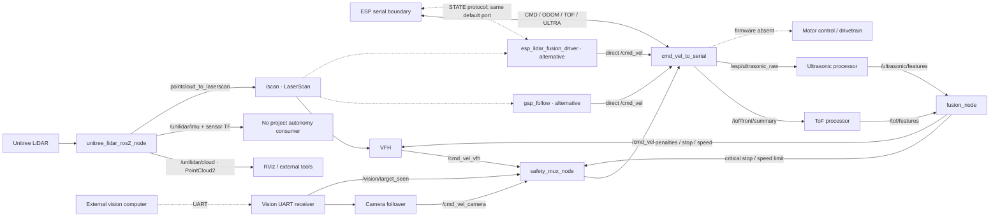
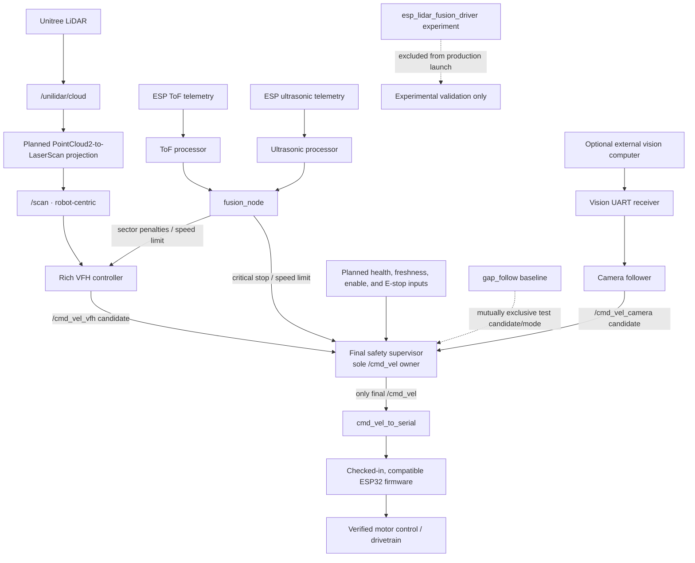

# Canonical Architecture

## How to read this document

This reference deliberately separates current implementation from the production target. Source code is authoritative for current behavior; [`../../CODEBASE_DEEP_DIVE.md`](../../CODEBASE_DEEP_DIVE.md) supplies the detailed static analysis. The target is governed by [`../decisions/ADR-001-canonical-stack.md`](../decisions/ADR-001-canonical-stack.md).

Solid arrows in the current diagram are **Verified from code** host-side connections. Dashed arrows represent external or physical dependencies. The fused launcher starts the LiDAR, projection, VFH, ultrasonic processor, fusion, and mux nodes. The serial bridge and ToF processor are optional launch arguments.

## LiDAR-only experimental launcher

**Verified from code** — `start_lidar_only.sh` now opens six tmux panes and starts the existing motor bridge on normal invocation, after startup checks; invocation is the user-requested operator enable. It excludes camera/fusion/alternative controllers and preserves the scan guards and bounded profile. The user-selected unchanged original v4 firmware is identified and checked stopped with AUTO disabled before the bridge starts; ARM is not sent. v4 per-direction US telemetry is adapted and DBG motor status is published. Navigation candidates use LiDAR only; original onboard sonar vetoes remain active. Default v4 emits no odometry and has no latched STOP. `stop_lidar_only.sh` provides a no-flags stop command. [Usage and evidence limits](../verification/lidar_only_launcher.md). It is not the complete production bring-up or physical autonomous-enable/E-stop system described below.

## Current repository architecture

**Verified from code** — The standalone port driver publishes `PointCloud2` on `/unilidar/cloud`, IMU data on `/unilidar/imu`, and sensor-frame TF. The fused launch selects the driver from `main` and starts the ROS `pointcloud_to_laserscan` projection in `unilidar_lidar`. The resulting `/scan` feeds VFH and its independent mux guard. The sensor origin still needs a measured alignment with the chassis. [Standalone port driver contract](../interfaces/unitree_driver_tf_contract.md) · [Fused launch details](../verification/fused_stack.md)

**Verified from code** — In the fused launch, the ultrasonic processor takes ESP32 telemetry from `cmd_vel_to_serial`. The fusion node sends directional penalties to the main-derived VFH and sends stop and speed limits to VFH and the mux. The mux owns `/cmd_vel`, which the serial bridge converts to ASCII `CMD`. The launch requires valid ultrasonic features and can also require ToF features. Camera following is available separately. [Fused launch details](../verification/fused_stack.md)

**Verified from code:** `gap_follow` and `vfh_with_esp_fusion` also default to publishing `/cmd_vel` directly. They bypass the mux and can conflict with it if launched simultaneously. The ESP-fusion alternative also defaults to the same serial device as the ESP bridge while using a different `STATE|...` receive contract.

**Likely intent:** An ESP32 performs sensor acquisition, odometry, motor mixing, and drivetrain control. Only the host serial interface supports this inference.

**Potential issue:** Firmware, motor-driver behavior, hardware watchdogs, and the physical emergency-stop circuit are absent, so actuation behavior beyond the serial boundary cannot be verified.

Current limitations relevant to integration include:

- **Verified from code** — Fused launch projects `/scan` in the sensor frame. A measured `base_link`-connected projection is pending.
- **Verified from code:** the Unitree wrapper selects the checked-in sibling SDK archive by supported Linux architecture, while target-Pi compile/link verification remains pending;
- **Verified from code:** multiple executable modes can own `/cmd_vel`;
- **Verified from code** — Fused launch defaults to zero final motion and halts on missing required perception. A physically verified operator enable and emergency stop remain deployment work.
- **Verified from code:** the LiDAR-only correction rejects invalid/stale scans in VFH and mux, keeps unknown sectors closed, removes the speed floor and open-loop escape, bounds serial requests, and latches serial faults. Automated software results are recorded separately from unverified physical behavior in [the stationary validation record](../verification/lidar_only_stationary.md).

These findings do not prove that uninspected hardware lacks independent protection.

## TARGET / PROPOSED robot-ready architecture

The primary production target is the rich VFH plus ToF/ultrasonic fusion path with one final safety supervisor. This section is a **Target architecture**; several connections and safety properties are not implemented today.

Target rules:

1. Only the final safety supervisor publishes production `/cmd_vel`; every controller publishes a named candidate.
2. `safety_mux_node` is the closest current starting point for this role, but later phases must verify or extend health, freshness, stop, enable, and fault behavior without renaming it in Phase 0.
3. Required input loss is handled by an explicit safe-state policy. Missing safety-critical data is not automatically clear.
4. Critical stop reaches the supervisor directly and is not delayed by candidate smoothing.
5. The approved bring-up makes production and alternative modes mutually exclusive and owns each serial device exactly once.
6. Host and MCU command-loss watchdogs, the physical emergency stop, speed limits, braking, and motor signs require physical verification.
7. Camera following is optional after the reactive avoidance stack is reliable. SLAM/Nav2 and other global autonomy capabilities remain deferred.

### First robot-ready release boundary

Required: Unitree LiDAR, verified robot-centric `/scan`, ToF, ultrasonic sensing, rich VFH navigation, deterministic sensor fusion, final safety arbitration, ESP bridge, checked-in compatible MCU firmware, one bring-up command, stopped startup, explicit autonomous enable, and low-speed controlled obstacle avoidance.

Optional/later: camera target following as a supervised candidate input.

Outside this release: SLAM, Nav2, mapping, global/waypoint planning, occupancy-grid navigation, full localization, Extended Kalman Filters, and other advanced probabilistic fusion.

## Known hardware-dependent unknowns

The repository cannot currently verify:

- exact deployed Unitree model/firmware and its physical transform to `base_link`;
- point-cloud projection height/filter settings, scan orientation, angular resolution, and measured TF;
- wheel radius, track width, gear ratio, encoder resolution, kinematics, motor polarity, driver type/pins, braking, and allowable speeds;
- ESP32 firmware, GPIO, command interpretation, acknowledgements, independent watchdog, and emergency-stop wiring;
- ToF model, unit, orientation, raw/matrix layout, and how firmware derives `CENTER`, `NEAR_MIN`, `NEAR_AVG`, and `FAR_AVG`;
- ultrasonic mounting geometry, cone/crosstalk behavior, and validity/no-echo contract;
- camera mounting transform, followed class, UART angle unit, and sign convention;
- stable serial device identities and deployed network configuration; and
- physical stopping distances and safe autonomous thresholds by speed and surface.

These values require human confirmation or measurement, named configuration, and provenance. They must not be inferred from typical hardware defaults.
