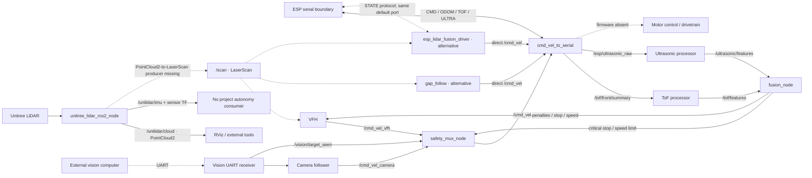
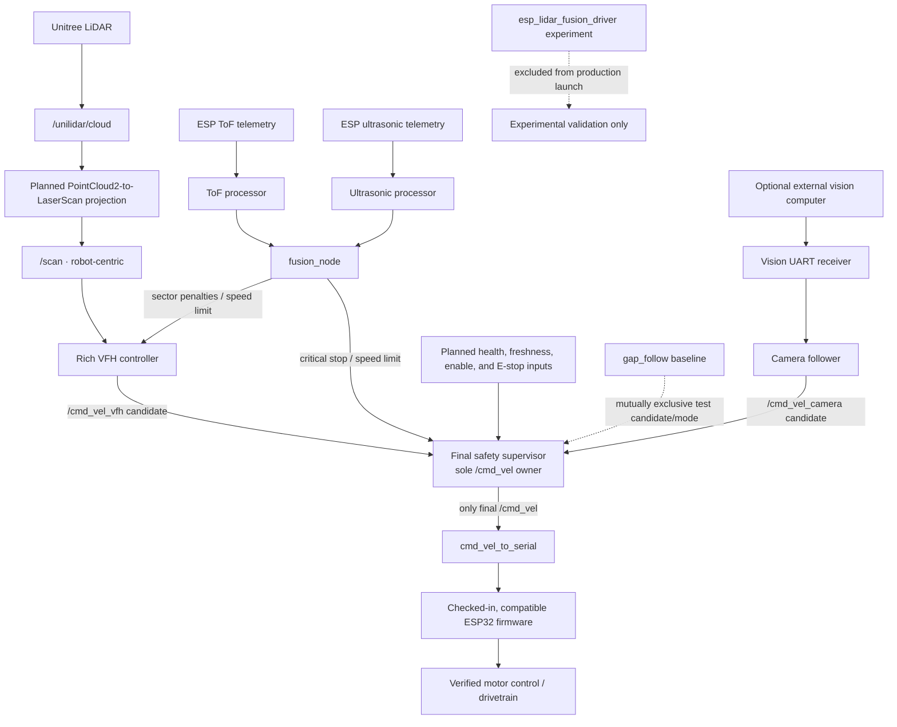

# Canonical Architecture

## How to read this document

This reference deliberately separates current implementation from the production target. Source code is authoritative for current behavior; [`../../CODEBASE_DEEP_DIVE.md`](../../CODEBASE_DEEP_DIVE.md) supplies the detailed static analysis. The target is governed by [`../decisions/ADR-001-canonical-stack.md`](../decisions/ADR-001-canonical-stack.md).

Solid arrows in the current diagram are **Verified from code** host-side connections. Dashed arrows are missing, external, physical, or otherwise not verifiable from this repository. The diagram does not assert that all shown executables are launched together; no complete bring-up exists.

## Current repository architecture

**Verified from code:** The Unitree ROS wrapper publishes `PointCloud2` on `/unilidar/cloud`, IMU data on `/unilidar/imu`, a dynamic initial-IMU-to-IMU transform, and a static IMU-to-LiDAR transform. It does not publish `LaserScan`. `gap_follow`, `vfh_obstacle_avoidance`, `vfh_with_esp_fusion`, and the LiDAR logger subscribe to `/scan`, for which no checked-in producer exists. The exact sensor contract and its hardware limitations are recorded in [`../interfaces/unitree_driver_tf_contract.md`](../interfaces/unitree_driver_tf_contract.md).

**Verified from code:** `cmd_vel_to_serial` receives `/cmd_vel`, sends an ASCII `CMD` line, and republishes parsed odometry, ToF summary, and ultrasonic data from its serial boundary. The ToF and ultrasonic processors feed `fusion_node`; the standalone VFH uses `/scan` plus fusion penalties/speed/stop and publishes `/cmd_vel_vfh`. Camera following publishes `/cmd_vel_camera`. `safety_mux_node` selects between those two candidates and publishes `/cmd_vel`.

**Verified from code:** `gap_follow` and `vfh_with_esp_fusion` also default to publishing `/cmd_vel` directly. They bypass the mux and can conflict with it if launched simultaneously. The ESP-fusion alternative also defaults to the same serial device as the ESP bridge while using a different `STATE|...` receive contract.

**Likely intent:** An ESP32 performs sensor acquisition, odometry, motor mixing, and drivetrain control. Only the host serial interface supports this inference.

**Potential issue:** Firmware, motor-driver behavior, hardware watchdogs, and the physical emergency-stop circuit are absent, so actuation behavior beyond the serial boundary cannot be verified.

Current limitations relevant to integration include:

- **Verified from code:** no `/scan` producer or `base_link`-connected sensor TF exists;
- **Verified from code:** the Unitree wrapper selects the checked-in sibling SDK archive by supported Linux architecture, while target-Pi compile/link verification remains pending;
- **Verified from code:** multiple executable modes can own `/cmd_vel`;
- **Verified from code:** the only launch starts the Unitree driver headlessly by default and can add RViz explicitly; it does not start `/scan`, navigation, fusion, serial actuation, or motors;
- **Potential issue:** missing/stale ToF, fusion, and other safety inputs can be retained or interpreted permissively in parts of the current graph; and
- **Potential issue:** invalid-but-nonempty scan behavior, critical-stop/escape interaction, and serial failure behavior require correction and verification in later phases.

These findings do not prove that uninspected hardware lacks independent protection.

## TARGET / PROPOSED robot-ready architecture

The primary production target is the rich VFH plus ToF/ultrasonic fusion path with one final safety supervisor. This section is a **Target architecture**; several connections and safety properties are not implemented today.

Target rules:

1. Only the final safety supervisor publishes production `/cmd_vel`; every controller publishes a named candidate.
2. `safety_mux_node` is the closest current starting point for this role, but later phases must verify or extend health, freshness, stop, enable, and fault behavior without renaming it in Phase 0.
3. Required input loss is handled by an explicit safe-state policy. Missing safety-critical data is not automatically clear.
4. Critical stop reaches the supervisor directly and is not delayed by candidate smoothing.
5. The approved bring-up makes production and alternative modes mutually exclusive and owns each serial device exactly once.
6. Host and MCU command-loss watchdogs, the physical emergency stop, speed limits, braking, and motor signs require physical verification.
7. Camera following is optional after the reactive avoidance stack is reliable. SLAM/Nav2 and other global autonomy capabilities remain deferred.

### First robot-ready release boundary

Required: Unitree LiDAR, verified robot-centric `/scan`, ToF, ultrasonic sensing, rich VFH navigation, deterministic sensor fusion, final safety arbitration, ESP bridge, checked-in compatible MCU firmware, one bring-up command, stopped startup, explicit autonomous enable, and low-speed controlled obstacle avoidance.

Optional/later: camera target following as a supervised candidate input.

Outside this release: SLAM, Nav2, mapping, global/waypoint planning, occupancy-grid navigation, full localization, Extended Kalman Filters, and other advanced probabilistic fusion.

## Known hardware-dependent unknowns

The repository cannot currently verify:

- exact deployed Unitree model/firmware and its physical transform to `base_link`;
- point-cloud projection height/filter settings, scan orientation, angular resolution, and measured TF;
- wheel radius, track width, gear ratio, encoder resolution, kinematics, motor polarity, driver type/pins, braking, and allowable speeds;
- ESP32 firmware, GPIO, command interpretation, acknowledgements, independent watchdog, and emergency-stop wiring;
- ToF model, unit, orientation, raw/matrix layout, and how firmware derives `CENTER`, `NEAR_MIN`, `NEAR_AVG`, and `FAR_AVG`;
- ultrasonic mounting geometry, cone/crosstalk behavior, and validity/no-echo contract;
- camera mounting transform, followed class, UART angle unit, and sign convention;
- stable serial device identities and deployed network configuration; and
- physical stopping distances and safe autonomous thresholds by speed and surface.

These values require human confirmation or measurement, named configuration, and provenance. They must not be inferred from typical hardware defaults.
